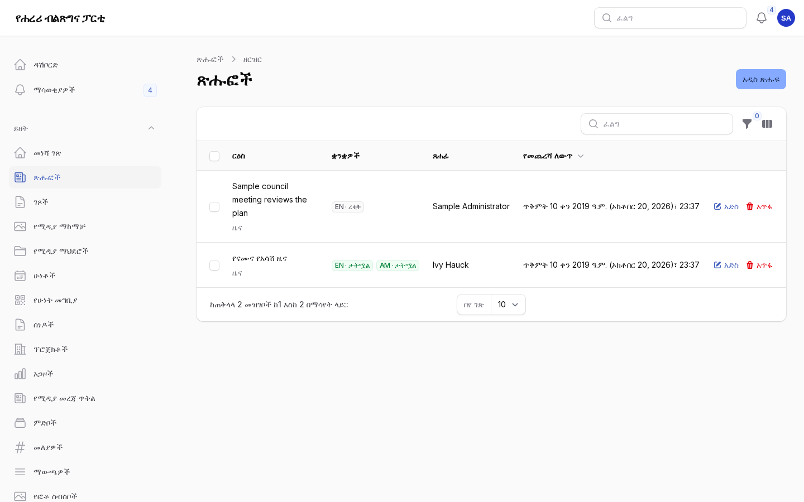
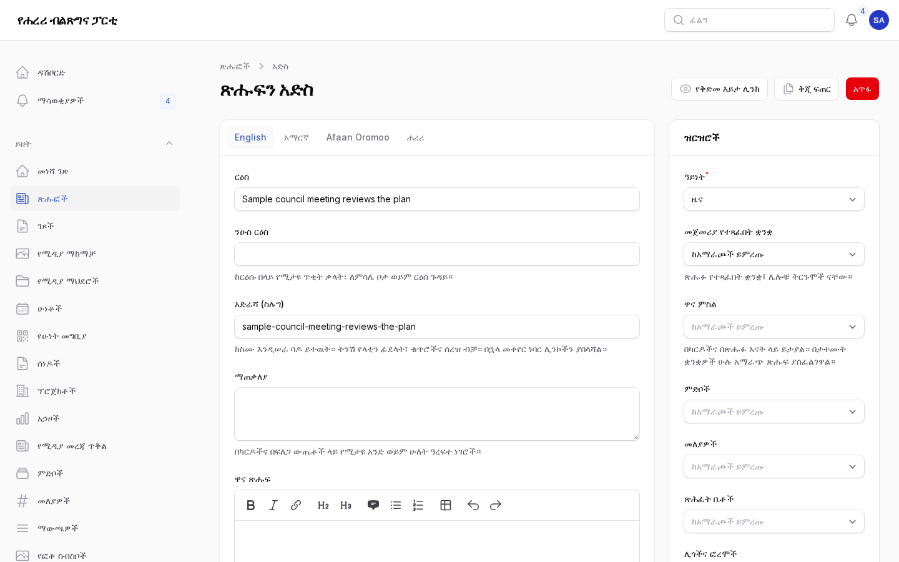

# ጽሑፍ ማተም

ለሐረሪ ክልል ቅርንጫፍ ጽሕፈት ቤት ጸሐፊዎች፣ አርታኢዎች፣ ተርጓሚዎችና አሳታሚዎች። ጽሑፍ ማለት ዜና፣ ጋዜጣዊ መግለጫ፣
መግለጫ፣ ንግግር ወይም ማስታወቂያ ነው። ይህ ምዕራፍ አንድን ጽሑፍ ከመጀመሪያው ረቂቅ እስከ ይፋዊው ድረ ገጽ በአራት ቋንቋዎች
ያደርሳል። የእንግሊዝኛው ቅጂ፦ [02-publishing-a-post.md](02-publishing-a-post.md)።

ማን ምን ያደርጋል፦

| ሚና | የሚችለው |
|---|---|
| ጸሐፊ | ረቂቅ መጻፍና ለግምገማ ማቅረብ |
| ተርጓሚ | ሌሎቹን ቋንቋዎች መጻፍና ማረም |
| አርታኢ | መጻፍ፣ ማንኛውንም ጽሑፍ ማረም፣ መገምገምና ለማስተካከያ መመለስ |
| አሳታሚ | ከላይ ያሉትን ሁሉ፣ በተጨማሪም ማተም፣ ቀን መወሰን፣ ከሕትመት ማውረድና በመነሻ ገጽ ላይ ማቅረብ |

## 1. ጽሑፉን ይጀምሩ

1. በአስተዳደር ክፍሉ **ይዘት → ጽሑፎች → አዲስ ጽሑፍ** ይክፈቱ።
2. በ**ዝርዝሮች** ስር (በቀኝ በኩል)፦ **ዓይነቱን** (ዜና፣ ጋዜጣዊ መግለጫ፣ መግለጫ፣ ንግግር ወይም ማስታወቂያ) እና
   **መጀመሪያ የተጻፈበትን ቋንቋ** ይምረጡ።
3. ከተፈለገ ጽሑፉን ከ**ምድቦች**፣ **መለያዎች**፣ **ጽሕፈት ቤቶች**፣ **ሊጎችና ፎረሞች** እና **ሰዎች** (ንግግሩን
   ያደረጉ ወይም ዜናው የሚመለከታቸው አመራሮች) ጋር ያገናኙ። የጽሕፈት ቤቱ፣ የሊጉና የአመራሩ ገጾች ጽሑፉን ይዘረዝራሉ።

## 2. በመጀመሪያው ቋንቋ ይጻፉ

እያንዳንዱ ቋንቋ የራሱ ትር አለው፦ English፣ አማርኛ፣ Afaan Oromoo፣ ሐረሪ። የሚጽፉበትን ቋንቋ ትር ከፍተው ይሙሉ፦

- **ርዕስ** (ግዴታ)። የድረ ገጹ አድራሻ (ስሉግ) ከርዕሱ በራሱ ይዘጋጃል፤ ርዕሱን በኋላ ቢቀይሩትም አይለወጥም፤ ስለዚህ
  ሊንኮች መሥራታቸውን ይቀጥላሉ።
- **ንዑስ ርዕስ** (አማራጭ)፦ ከርዕሱ በላይ የሚታይ አጭር መስመር፤ ለምሳሌ "ጋዜጣዊ መግለጫ"።
- **ማጠቃለያ**፦ በካርዶች፣ በማጋሪያ ቅድመ ዕይታዎችና በፍለጋ ውጤቶች ላይ የሚታዩ አንድ ወይም ሁለት ዓረፍተ ነገሮች።
- **ዋና ጽሑፍ**፦ ዜናው ራሱ። የመሣሪያ አሞሌው ርዕሶችን፣ ዝርዝሮችን፣ ጥቅሶችን፣ ሰንጠረዦችንና ሊንኮችን ይዟል። **+** ን
  በመጫን **ፎቶ**፣ **የፎቶ ስብስብ**፣ **ቪዲዮ** (የዩቲዩብ ሊንክ)፣ **ማሳሰቢያ ሳጥን** ወይም **ፋይል** ይጨምሩ።

ደጋግመው **አስቀምጥ** ይጫኑ። እያንዳንዱ ማስቀመጥ ቅጂ ይይዛል፤ ከታች ያለው **ቅጂዎች** ለውጦችን ያሳያል፤ የቀድሞውንም
መመለስ ይችላል።

## 3. ዋናውን ፎቶ ይጨምሩ

1. በ**ዝርዝሮች** ስር **ዋና ምስል** ን መርጠው ከሚዲያ ማከማቻው ፎቶ ይምረጡ (ወይም መጀመሪያ በ**ሚዲያ** ውስጥ ይጫኑ)።
2. ፎቶው በሚታተምበት በእያንዳንዱ ቋንቋ **አማራጭ ጽሑፍ** ያስፈልገዋል፤ ይህም ማየት ለማይችሉ ሰዎች የሚሆን አጭር
   መግለጫ ነው። በ**ሚዲያ → ፎቶው → አማራጭ ጽሑፍ** ውስጥ ለእንግሊዝኛ፣ ለአማርኛና ለአፋን ኦሮሞ ይጻፉ። እስኪሞላ
   ድረስ ማተም አይፈቀድም።
3. ከፎቶው ስር እንዲታይ በፎቶው ላይ **የፎቶ ምንጭ** (ፎቶውን ያነሳው) ይሙሉ።

## 4. ለግምገማ ያቅርቡ

የመጀመሪያው ቋንቋ ሲዘጋጅ በዚያው ቋንቋ ትር ውስጥ **ለግምገማ አቅርብ** ን ይምረጡ። ሁኔታው *በግምገማ ላይ* ይሆናል፤
ገምጋሚዎችም በደወሉና በኢሜይል ማሳወቂያ ይደርሳቸዋል።

አርታኢ ወይም አሳታሚ አንብቦ፦

- **እንደተገመገመ ምልክት አድርግ** — ለሕትመት ዝግጁ ነው፤ ወይም
- **ለማስተካከያ መልስ** — ምን መቀየር እንዳለበት አስተያየት በመጻፍ። ጸሐፊው ይነገረዋል፤ አስተያየቱም በ**የውስጥ አስተያየቶች**
  ስር ከጽሑፉ ጋር ይቀመጣል።

## 5. ይተርጉሙ

ተርጓሚዎች ያንኑ ጽሑፍ ከፍተው የሌሎቹን ቋንቋዎች ትሮች (ርዕስ፣ ማጠቃለያ፣ ጽሑፍ) ይሞላሉ። እያንዳንዱ ቋንቋ የራሱ ሁኔታ
ስላለው የአፋን ኦሮሞው እየተተረጎመ የአማርኛው ሊታተም ይችላል። በትርጉም ግምገማ ዝርዝር ውስጥ ያሉትን የቃላት ማሳሰቢያዎች
ይከተሉ፤ የማሽን ትርጉም መነሻ ብቻ ነው፤ በሰው መረጋገጥ አለበት።

ሐረሪ፦ ጽሑፉ የሐረሪ ቅጂ ከሌለው የሐረሪ ድረ ገጽ አንባቢዎች አማርኛ መሆኑ ተገልጾ የአማርኛውን ያያሉ።

## 6. ቅድመ ዕይታ

በጽሑፉ አናት ላይ **የቅድመ እይታ ሊንክ** ን መርጠው ቋንቋ ይምረጡ። ሊንኩ ጽሑፉ ረቂቅ ቢሆንም አንባቢዎች እንደሚያዩት
በትክክል ያሳያል፤ ለ7 ቀናትም ይሠራል። የአስተዳደር መለያ ለሌላቸው ባልደረቦች ይላኩት።

## 7. ያትሙ ወይም ቀን ይወስኑ (አሳታሚዎች)

በእያንዳንዱ ቋንቋ ትር ውስጥ፦

- **አትም** — ቋንቋው ወዲያውኑ ይፋ ይሆናል።
- **ቀጠሮ ያዝ** — ቀንና ሰዓት ይምረጡ፤ በዚያ ሰዓት በአንድ ደቂቃ ውስጥ ይፋ ይሆናል።

አሳታሚ በ**ዝርዝሮች** ስር **በመነሻ ገጽ ላይ ጎልቶ የሚታይ** (ጽሑፉ በመነሻ ገጹ ዋና ክፍል ሊታይ ይችላል) ወይም
**ከላይ የተሰካ** (በዜና ዝርዝሮች ውስጥ አንደኛ ሆኖ ይቆያል) ን መምረጥ ይችላል።

አንድን ቋንቋ ከድረ ገጹ ለማውረድ **ከሕትመት አውርድ** ን ይምረጡ፤ **በማህደር አስቀምጥ** ይዞ በቋሚነት ይደብቀዋል።
**እንደ ረቂቅ እንደገና ክፈት** በማህደር የተቀመጠን ቋንቋ ለማረም ይመልሰዋል።

## 8. ይፋዊውን ድረ ገጽ ይፈትሹ

ድረ ገጹን በእያንዳንዱ ቋንቋ ይክፈቱ፤ ለምሳሌ https://hararipp.orcamind.dev/am/news ፤ ጽሑፉን ያግኙ። ርዕሱን፣
ፎቶውንና ምንጩን፣ ጽሑፉንና ወደ ሌሎች ቋንቋዎች የሚወስዱትን "በሚከተሉት ቋንቋዎችም ይገኛል" ሊንኮች ይፈትሹ። የታተመ ጽሑፍ
አድራሻ በኋላ ቢቀየር የቀድሞው አድራሻ መሥራቱን ይቀጥላል (ወደ አዲሱ ያዞራል)።

## 9. ከቻናሎች የሚመጡ ዜናዎች

ከቅርንጫፉ የቴሌግራም ቻናልና ከክልሉ የመንግሥት ኮሙኒኬሽን ጉዳዮች ጽሕፈት ቤት ቻናል የሚወጡ አዳዲስ ዜናዎች በየግማሽ
ሰዓቱ እንደ ረቂቅ ይገባሉ። በ**ጽሑፎች** ውስጥ **ከቻናሎች የመጡ** በሚለው ማጣሪያ ያገኟቸዋል። የገባን ዜና ከማተምዎ በፊት፦

1. በ**የመጣው ከ** ስር ያለውን የምንጭ ሊንክ ከፍተው ስሞችን፣ ማዕረጎችንና እውነታዎችን ያነጻጽሩ።
2. ርዕሱንና ጽሑፉን ያርሙ፤ ትክክለኛውን የቋንቋ ትር ይምረጡ (በሐረሪ የተጻፉ ዜናዎች በአማርኛው ትር ውስጥ ይገባሉ)፤
   የጎደሉትን ቋንቋዎችና አማራጭ ጽሑፍ ይጨምሩ።
3. ከዚያም እንደማንኛውም ጽሑፍ ደረጃ 4–8ን ይከተሉ። የታተሙ የገቡ ዜናዎች "ምንጭ፦" ከሊንኩ ጋር ያሳያሉ።

ከኮሙኒኬሽን ጽሕፈት ቤቱ ቻናል የሚመጡ ዜናዎች የሚታተሙት ጽሕፈት ቤቱ ቅርንጫፉ ይዘቱን እንደገና እንዲያትም ከፈቀደ በኋላ ብቻ
ነው፤ እስከዚያው እንደ ረቂቅ ይቆዩ ወይም ለመረጃ ብቻ ይጠቀሙባቸው።

## መነሻ ገጽ

አሳታሚዎች መነሻ ገጹን በ**ይዘት → መነሻ ገጽ** ውስጥ ያደራጃሉ፦ ክፍሎችን በመጎተት ቅደም ተከተል ያስይዛሉ፣ ያበሯቸዋል
ወይም ያጠፏቸዋል፤ ለዋናው ክፍልና ለሰበር ዜና መስመሩ ዜናዎችን በእጅ ይመርጣሉ።

## ገጾቹ ምን እንደሚመስሉ

የአስተዳደር ክፍሉ ምስሎች ከናሙና ይዘት ጋር (የአስተዳደር ቋንቋ፦ አማርኛ)።

