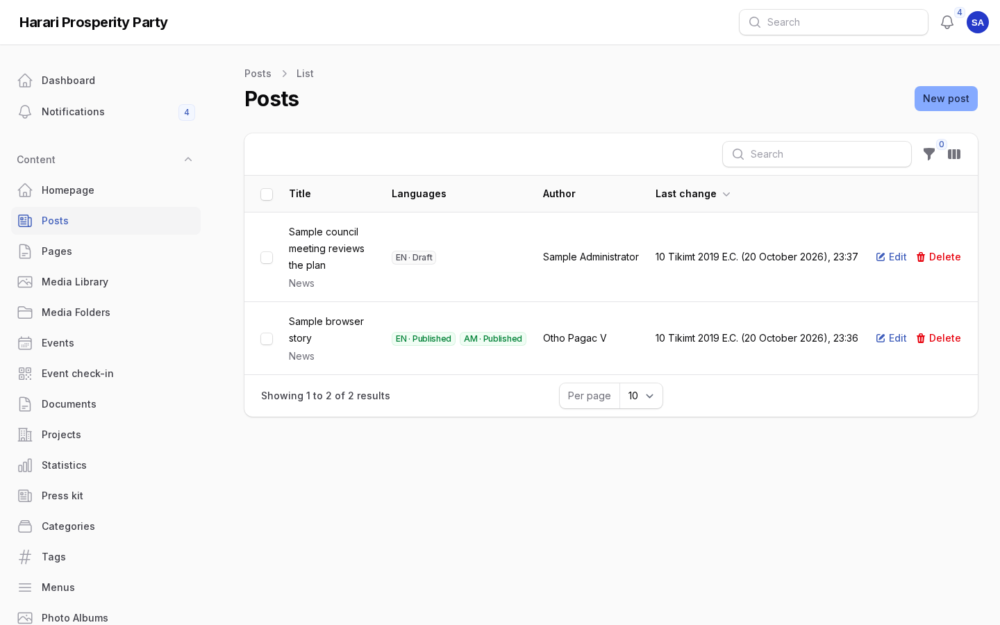
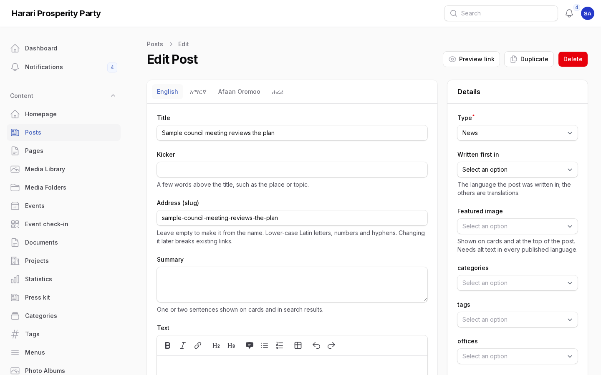

# Publishing a post

For authors, editors, translators and publishers of the Harari Regional Branch Office. A post is a news
item, press release, statement, speech or announcement. This chapter takes one post from the first draft
to the public site in four languages. Amharic version: [02-publishing-a-post.am.md](02-publishing-a-post.am.md).

Who does what:

| Role | Can do |
|---|---|
| Author | Write drafts and submit them for review |
| Translator | Write and correct the other languages |
| Editor | Write, edit any post, review and send back |
| Publisher | Everything above, plus publish, schedule, unpublish and feature on the homepage |

## 1. Start the post

1. In the admin, open **Content → Posts → New post**.
2. Under **Details** (right side): choose the **Type** (news, press release, statement, speech or
   announcement) and **Written first in** (the language you write in).
3. Optionally link the post to **Categories**, **Tags**, **Offices**, **Leagues and forums** and
   **People** (the leaders who gave the speech or whom the story is about). Office, league and leader
   pages then list the post.

## 2. Write it in the first language

Each language has its own tab: English, አማርኛ, Afaan Oromoo, ሐረሪ. Open the tab of the language you
write in and fill in:

- **Title** (required). The web address (slug) is made from it automatically and never changes when you
  edit the title later, so links keep working.
- **Kicker** (optional): a short line above the title, e.g. "Press release".
- **Summary**: one or two sentences shown on cards, in sharing previews and search results.
- **Text**: the story. The toolbar has headings, lists, quotes, tables and links. Use **+** to add a
  **Photo**, **Gallery**, **Video** (YouTube link), **Highlighted note** or **File**.

Choose **Save** often. Every save keeps a version; **Versions** at the bottom shows changes and can
restore an earlier one.

## 3. Add the featured photo

1. Under **Details**, choose **Featured image** and pick a photo from the media library (or upload one in
   **Media** first).
2. The photo needs **alt text** — a short description for people who cannot see it — in every
   language you publish. Write it in **Media → the photo → Alt text** for English, Amharic and Afaan
   Oromo. Publishing is refused until it is there.
3. Fill in **Credit** on the photo (who took it) so it is shown under the picture.

## 4. Submit for review

When the first language is ready, choose **Submit for review** in that language's tab. The status
becomes *In review* and reviewers get a notification in the bell and by email.

An editor or publisher reads it and either:

- **Mark as reviewed** — it is ready to publish, or
- **Send back** with a comment saying what to change. The author is notified; the comment is kept with
  the post under **Internal comments**.

## 5. Translate

Translators open the same post and fill in the other language tabs (title, summary, text). Each language
has its own status, so the Amharic version can be published while the Afaan Oromo one is still being
translated. Follow the wording notes in the translation review list; machine translation is only a
starting point and must be checked by a person.

Harari: if a post has no Harari version, readers of the Harari site see the Amharic one, marked as
Amharic.

## 6. Preview

Choose **Preview link** at the top of the post and pick a language. The link shows the post exactly as
readers will see it, even as a draft, and works for 7 days. Send it to colleagues who do not have an
admin account.

## 7. Publish or schedule (publishers)

In each language tab:

- **Publish** — the language goes live at once.
- **Schedule** — choose the date and time; it goes live within a minute of that time.

Under **Details**, a publisher can also tick **Featured on the homepage** (the post can appear in the
homepage hero) or **Pinned to the top** (stays first in news lists).

To take a language off the site, choose **Unpublish**; **Archive** keeps it but hides it for good.
**Reopen as draft** brings an archived language back for editing.

## 8. Check the public site

Open the site in each language, e.g. https://hararipp.orcamind.dev/en/news, and find the post. Check
the title, photo and credit, the text and the "Also available in" links to the other languages.
Changing the address of a published post later keeps the old address working (it redirects).

## 9. Stories imported from the channels

New stories from the branch's Telegram channel and the regional communication office's channel arrive
every half hour as drafts. Find them with the **Imported from channels** filter in **Posts**. Before
publishing an imported story:

1. Open the source link shown under **Imported from** and compare names, titles and facts.
2. Correct the title and text, choose the right language tab (stories in Harari arrive in the Amharic
   tab), add the missing languages and alt text.
3. Then follow steps 4–8 as for any post. Published imported stories show "Source:" with the link.

Stories from the communication office's channel are published only once the office has agreed that the
branch may republish its material; until then keep them as drafts or use them as background.

## Homepage

Publishers arrange the homepage under **Content → Homepage**: drag sections into order, switch them on
or off, and hand-pick the stories for the hero and the breaking-news ticker.

## Screens

Screenshots of the admin with sample content (English admin language).

