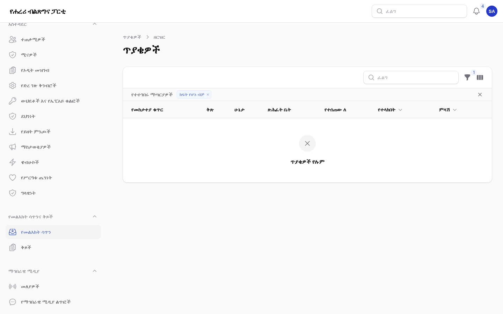

# ሁነቶች፣ ሰነዶችና ቅጾች

ለሐረሪ ክልል ቅርንጫፍ ጽሕፈት ቤት ሁነቶችን፣ የሰነዶች ቤተ መጻሕፍትን፣ ፕሮጀክቶችን፣ ቅጾችንና የመልእክት
ሳጥኑን ለሚያስተዳድሩ ሠራተኞች። እያንዳንዱ ክፍል ሥራውን ማን ሊያከናውን እንደሚችል ይገልጻል። የእንግሊዝኛው ቅጂ፦
[03-events-documents-forms.md](03-events-documents-forms.md)።

እዚህ ያለው ሁሉ እንደ ጽሑፎች በየቋንቋው ይጻፋል፦ እያንዳንዱ ቋንቋ የራሱ ትር አለው፤ አንድ ቋንቋ ለሕዝብ የሚታየው
**የታተመ** የሚለው ማብሪያ ሲበራ ብቻ ነው። የሐረሪ ጽሑፍ ገና በሌለበት የሐረሪ አንባቢዎች የአማርኛውን ያያሉ።

## 1. ሁነቶች

ማን፦ አርታዒዎችና አሳታሚዎች (**ይዘት → ሁነቶች**)።

1. **አዲስ ሁነት** ይምረጡ። ርዕሱን ቢያንስ በአንድ ቋንቋ ይስጡ፤ ከዚያም **አጭር መግለጫ**፣ **ስለ ሁነቱ**፣ **ቦታ**
   እና **አድራሻ** ይሙሉ።
2. **መርሐ ግብሩን** በየመስመሩ (ሰዓትና የሚካሄደው) ይጨምሩ። እያንዳንዱ ቋንቋ የራሱ መርሐ ግብር አለው።
3. በቀኝ በኩል **የሚጀምርበት** እና **የሚያበቃበት** ጊዜ በአዲስ አበባ ሰዓት ያስገቡ፤ ወይም **ቀኑን ሙሉ** ያብሩ።
4. **የት** በሚለው ስር የካርታ ነጥቡን (ኬክሮስና ኬንትሮስ) ወይም **የመስመር ላይ ሊንክ** (https ብቻ) ይጨምሩ።
5. ከአመራር ማውጫው **ተናጋሪዎችን**፣ **ዋና ፎቶ** እንዲሁም ጽሕፈት ቤቱን ወይም ሊጉን ይምረጡ።
6. በተጠናቀቀ እያንዳንዱ ቋንቋ **የታተመ** የሚለውን አብርተው ያስቀምጡ።

ሁነቱ በ`/{language}/events`፣ በወር ማሳያው፣ በመነሻ ገጹ ("መጪ ሁነቶች") እና በፍለጋ ይታያል። ጎብኚዎች ሁነቱን
ወደ ቀን መቁጠሪያቸው (.ics ወይም Google Calendar) መጨመር ወይም ለሁሉም ሁነቶች መመዝገብ ይችላሉ።

### ምዝገባ

1. በሁነቱ ውስጥ **ምዝገባ** የሚለውን ከፍተው **ሰዎች መመዝገብ ይችላሉ** የሚለውን ያብሩ።
2. **የቦታ ብዛት** (ባዶ ከሆነ ገደብ የለውም)፣ **ሲሞላ የመጠባበቂያ ዝርዝር** ይኑር አይኑር እና **ምዝገባ
   የሚዘጋበትን** ጊዜ (ያለበለዚያ ሁነቱ ሲጀምር) ያስገቡ።
3. የሁነቱ ገጽ አሁን **ይመዝገቡ** የሚል ቁልፍ ያሳያል። ሰዎች ስምና ስልክ ቁጥር ወይም የኢሜይል አድራሻ ይሰጣሉ፤ የQR
   ኮድ ያለው ትኬት በኢሜይልና በጽሑፍ መልእክት ይደርሳቸዋል። (የኤስኤምኤስ አቅራቢ እስኪመረጥ ድረስ የጽሑፍ መልእክቶች
   በመዝገብ ውስጥ ብቻ ይጻፋሉ።)
4. አንድ ሰው ሲሰርዝ በመጠባበቂያ ዝርዝሩ ላይ ያለው የመጀመሪያው ሰው ቦታውን ያገኛል፤ ይነገረዋልም። የቦታ ብዛቱን
   መጨመርም ተመሳሳይ ውጤት አለው።

የሁነቱ **ምዝገባዎች** ትር ሁሉንም ተመዝጋቢዎች ይዘረዝራል (ምዝገባዎችን ማየት ለተፈቀደላቸው ሠራተኞች ብቻ)። ከዚያ
ሰዎችን ማስገባት፣ ቦታ መሰረዝ ወይም ዝርዝሩን እንደ ሠንጠረዥ (CSV) ማውረድ ይቻላል። ምዝገባዎች ሁነቱ ካለቀ ከ180
ቀናት በኋላ በራሳቸው ይሰረዛሉ።

### በመግቢያው ላይ

በስልክ ወይም በታብሌት **ይዘት → የሁነት መግቢያ** የሚለውን ይክፈቱ። የትኬቱን የQR ኮድ በካሜራ መቃኘት ትኬቱ
የተሞላበትን ይህን ገጽ ይከፍታል፤ ስሙን አረጋግጠው **አስገባ** የሚለውን ይምረጡ። አንድ ትኬት አንድ ጊዜ ብቻ
ያገለግላል፤ ሁለተኛ ቅኝት ትኬቱ መቼ ጥቅም ላይ እንደዋለ ያሳያል። ኮዶችን የሚጽፍ መቃኛም ይሠራል።

## 2. ሰነዶች፣ ክፍት የሥራ ቦታዎችና ጨረታዎች

ማን፦ አርታዒዎችና አሳታሚዎች (**ይዘት → ሰነዶች**)።

1. መጀመሪያ ፋይሉን በ**ሚዲያ** ይጫኑ (PDF፣ Word፣ Excel …)፤ ወይም ያለውን ይምረጡ።
2. **አዲስ ሰነድ** ይምረጡ፤ ከዚያም **ዓይነቱን**፦ ለቤተ መጻሕፍቱ ፕሮግራም፣ ማኒፌስቶ፣ መተዳደሪያ ደንብ፣ ሪፖርት፣
   ፖሊሲ፣ ንግግር፣ ቅጽ ወይም ህትመት፤ ለማስታወቂያዎች ገጽ ክፍት የሥራ ቦታ፣ ጨረታ ወይም ማስታወቂያ።
3. **ዓመት**፣ **የወጣበት ቀን**፣ ጽሕፈት ቤት ወይም ሊግ እና **ተዛማጅ ሰነዶችን** ይሙሉ።
4. በየቋንቋው ርዕስ፣ አጭር መግለጫና **በዚህ ቋንቋ ያለ ፋይል** ይስጡ። የራሱ ፋይል የሌለው ቋንቋ የሌላ ቋንቋ ፋይልን
   ከማስታወሻ ጋር ያሳያል።
5. ለክፍት የሥራ ቦታዎች፣ ለጨረታዎችና ለማስታወቂያዎች **የመጨረሻ ቀን** ያስገቡ። ከዚያ በኋላ ማስታወቂያው እንደተዘጋ
   ይታያል።

የተስተካከለ ፋይል ለማውጣት አዲሱን ፋይል ይምረጡና **በዚህ ስሪት የተለወጠውን** ይጻፉ። የቀድሞው ፋይል **ቀደምት
ስሪቶች** በሚለው ስር ይቀመጣል፤ ከዚያ ሊወርድ ወይም እንደገና የአሁኑ ሊደረግ ይችላል።

ቤተ መጻሕፍቱ በ`/{language}/documents` ላይ በዓይነት፣ በዓመትና በጽሕፈት ቤት ማጣሪያዎች ይገኛል፤ ማስታወቂያዎች
በ`/{language}/notices` ላይ ናቸው። PDF ፋይሎች በገጹ ውስጥ ይከፈታሉ። ውርዶች ይቆጠራሉ።

## 3. ፕሮጀክቶችና አኃዞች

ማን፦ አርታዒዎችና አሳታሚዎች (**ይዘት → ፕሮጀክቶች** እና **ይዘት → አኃዞች**)።

- መጀመሪያ **ዘርፎቹን** "ለፕሮጀክት ዘርፎች የሚያገለግሉ" ምድቦች አድርገው ይፍጠሩ (**ይዘት → ምድቦች**)።
- ፕሮጀክት ዘርፍ፣ ጽሕፈት ቤት ወይም ወረዳ፣ ደረጃ (የታቀደ፣ በሂደት ላይ፣ የተጠናቀቀ፣ የተቋረጠ)፣ አፈጻጸም በመቶኛ፣
  የሚጀምርበትና የሚያበቃበት ቀን፣ የካርታ ነጥብ፣ የሽፋን ፎቶና የፎቶ ስብስብ አለው። **በጀቱ** የሚታየው **በጀቱን በድረ
  ገጹ ላይ አሳይ** ሲበራ ብቻ ነው።
- አኃዝ በየቋንቋው የሚቆጥረው፣ መለኪያና ምንጭ ያለው ቁጥር ሲሆን እስከ ቀን አለው። ከዘርፍ (የስኬቶች ገጽ)፣ ከፕሮጀክት
  (የፕሮጀክት ገጽ) ጋር ያያይዙት፤ ወይም ከሁለቱም ጋር ሳያያይዙት ይተዉት ("በክልሉ ደረጃ" ይታያል)።
- አኃዞችን በገጽ ወይም በጽሑፍ ውስጥ ለማሳየት በጽሑፉ ውስጥ **+ → አኃዞች** የሚለውን ይጠቀሙና ይምረጧቸው።

ፕሮጀክቶች በ`/{language}/projects`፣ ስኬቶች በዘርፍ በ`/{language}/achievements` ላይ ናቸው።

## 4. ቅጾችና የመልእክት ሳጥን

ቅጽ የሚገነቡት፦ አሳታሚዎችና የኮሙኒኬሽን ኃላፊዎች (**የመልእክት ሳጥንና ቅጾች → ቅጾች**)። ምላሽ የሚሰጡት፦ የድጋፍ
ባለሙያዎችና አሳታሚዎች፣ እያንዳንዳቸው ሚናቸው ለሚሸፍናቸው ጽሕፈት ቤቶች (**የመልእክት ሳጥንና ቅጾች → የመልእክት
ሳጥን**)።

### ቅጽ መገንባት

1. **አዲስ ቅጽ** ይምረጡና **ዓላማውን** (መገናኛ፣ አስተያየት፣ አቤቱታ፣ የሚዲያ ጥያቄ፣ የሥራ ማመልከቻ) ይምረጡ።
2. በየቋንቋው፦ ርዕስ፣ መግቢያ፣ የምስጋና መልእክትና ራስ-ሰር ምላሽ።
3. **ጥያቄዎች** በሚለው ስር የቅጹን የራሱን ጥያቄዎች ይጨምሩ። ስም፣ ኢሜይልና ስልክ ሁልጊዜ መጀመሪያ ይጠየቃሉ።
   እያንዳንዱን ጥያቄ በሁሉም ቋንቋ ይጻፉ፤ ለዝርዝሮችና ለምርጫዎች በየመስመሩ አንድ ምርጫ፣ በሁሉም ቋንቋ በተመሳሳይ
   ቅደም ተከተል ይጻፉ።
4. **ማን ምላሽ ይሰጣል** በሚለው ስር ጽሕፈት ቤቱን፣ ስለ አዲስ መልእክቶች የሚነገረውን አድራሻ እና በስንት የሥራ
   ቀናት ውስጥ ምላሽ እንደሚሰጥ ይምረጡ። ለመገናኛ ቅጹ **በመገናኛ ገጹ ላይ አሳይ** የሚለውን ያብሩ።

እያንዳንዱ መልእክት እንደ `HPP-7K3D-9Q2M` ያለ የመከታተያ ቁጥር ያለው ጥያቄ ይሆናል። ላኪው ቁጥሩን በኢሜይል ይቀበላል፤
ሁኔታውንም በ`/{language}/tickets` ላይ መከታተል ይችላል። ያ ገጽ የጻፉትን በፍጹም አያሳይም።

### ለጥያቄ ምላሽ መስጠት

1. ጥያቄውን ከ**የመልእክት ሳጥን** ይክፈቱ። ቀዩ **ምላሽ** ዓምድ ጊዜያቸው ያለፈባቸውን ጥያቄዎች ያሳያል።
2. ለሥራ ባልደረባ **ይስጡት**፤ ወይም **ምላሽ ይስጡ**፦ ምላሹ በላኪው ቋንቋ በኢሜይል ይላካል፤ የምላሽ ሰዓቱም ይቆማል።
   ጥያቄውን በዚያው ለመዝጋት **ይህ ጥያቄውን ይመልሳል** የሚለውን ይምረጡ።
3. ባልደረቦች ብቻ ሊያነቡት ለሚገባ ነገር **የውስጥ ማስታወሻ** ይጠቀሙ። **ሁኔታ ቀይር** ጥያቄውን ወደሚቀጥለው ደረጃ
   ያሸጋግረዋል።
4. የተያያዙ ፋይሎች **ዓባሪዎች** በሚለው ስር ናቸው። እያንዳንዱ እርምጃ **ታሪክ** በሚለው ስር ይዘረዘራል።

## 5. የሚዲያ መረጃ ጥቅልና ፎቶዎች

- **ይዘት → የሚዲያ መረጃ ጥቅል**፦ በየቋንቋው ይፋዊ አጭር መግለጫ፣ የሚዲያ ግንኙነት፣ የአርማ ፋይሎችና የሚዲያ ጥያቄ ቅጹ።
  ፎቶዎቹ ከአመራር ማውጫው ከሥራ አስፈጻሚ ኮሚቴው ይወሰዳሉ። ገጹ `/{language}/press` ነው።
- **ይዘት → የፎቶ ስብስቦች** እና **ይዘት → ቪዲዮዎች**፦ በየቋንቋው መግለጫ ያላቸው የቤተ መጻሕፍት ፎቶ ስብስቦች፣ እንዲሁም
  የYouTube፣ Facebook ወይም Telegram ቪዲዮዎች ከቀጥታ ስርጭት ገጽ ጋር በ`/{language}/live`።

## ገጾቹ ምን እንደሚመስሉ

የአስተዳደር ክፍሉ ምስሎች ከናሙና ይዘት ጋር (የአስተዳደር ቋንቋ፦ አማርኛ)።

