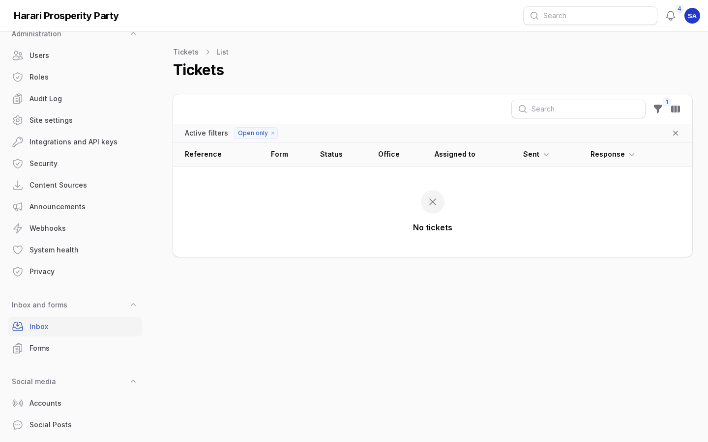

# Events, documents and forms

For staff of the Harari Regional Branch Office who look after events, the documents library, projects,
forms and the inbox. Each section says who may do it. Amharic version:
[03-events-documents-forms.am.md](03-events-documents-forms.am.md).

Everything here is written per language, like posts: each language has its own tab, and a language is
public only once its **Published** switch is on. Harari readers see the Amharic text where there is no
Harari one yet.

## 1. Events

Who: editors and publishers (**Content → Events**).

1. Choose **New event**. Give the title in at least one language, then the **Short description**,
   **About the event**, **Venue** and **Address**.
2. Add the **Agenda** line by line (time and what happens). Each language has its own agenda.
3. On the right, set **Starts** and **Ends** in Addis Ababa time, or switch on **All day**.
4. Under **Where**, add the map pin (latitude and longitude) or an **Online link** (https only).
5. Choose **Speakers** from the leadership directory, a **Featured photo**, and the office or league.
6. Switch on **Published** in each finished language and save.

The event appears at `/{language}/events`, in the month view, on the homepage ("Upcoming events") and in
search. Visitors can add it to their calendar (.ics or Google Calendar) or subscribe to all events.

### Registration

1. In the event, open **Registration** and switch on **People can register**.
2. Set the number of **Places** (empty means no limit), whether there is a **Waiting list when full**,
   and when **Registration closes** (otherwise at the start).
3. The event page now shows **Register**. People give a name and a phone number or email address and
   receive a ticket with a QR code by email and text message. (Text messages are only written to the
   log until an SMS provider is chosen.)
4. When someone cancels, the first person on the waiting list gets the place and is told so. Raising
   the number of places does the same.

The **Registrations** tab of the event lists everyone (only for staff allowed to see registrations).
From there you can check people in, cancel a place, or download the list as a spreadsheet (CSV).
Registrations are deleted automatically 180 days after the event.

### At the door

Open **Content → Event check-in** on a phone or tablet. Scanning a ticket's QR code with the camera
opens this page with the ticket filled in: check the name and choose **Check in**. A ticket can be
used once; a second scan shows when it was used. A scanner that types codes works too.

## 2. Documents, vacancies and tenders

Who: editors and publishers (**Content → Documents**).

1. Upload the file first in **Media** (PDF, Word, Excel …), or choose an existing one.
2. Choose **New document**, then the **Type**: programme, manifesto, bylaw, report, policy, speech, form
   or publication for the library; vacancy, tender or notice for the notices page.
3. Fill in the **Year**, **Date issued**, office or league, and **Related documents**.
4. In each language give the title, a short description and the **File in this language**. A language
   without its own file shows the file of another language with a note.
5. For vacancies, tenders and notices, set the **Deadline**. After it the notice is listed as closed.

To publish a corrected file, choose the new file and write **What changed in this version**. The old
file is kept under **Earlier versions**, where it can be downloaded or made current again.

The library is at `/{language}/documents` with filters by type, year and office; notices are at
`/{language}/notices`. PDFs open inside the page. Downloads are counted.

## 3. Projects and statistics

Who: editors and publishers (**Content → Projects** and **Content → Statistics**).

- First create the **sectors** as categories "used for project sectors" (**Content → Categories**).
- A project has a sector, an office or woreda, a status (planned, ongoing, completed, paused), progress
  in per cent, start and end dates, a map pin, a cover photo and a photo album. The **Budget** is shown
  only when **Show the budget on the website** is on.
- A statistic is a number with what it counts, a unit and a source in each language, and an as-of date.
  Link it to a sector (achievements page), to a project (project page), or to neither (shown "across the
  region").
- To show numbers inside a page or post, use **+ → Statistics** in the text and choose them.

Projects are at `/{language}/projects`; achievements by sector at `/{language}/achievements`.

## 4. Forms and the inbox

Who builds forms: publishers and communications officers (**Inbox and forms → Forms**). Who answers:
support agents and publishers, each for the offices their role covers (**Inbox and forms → Inbox**).

### Build a form

1. Choose **New form** and its **Purpose** (contact, feedback, petition, press enquiry, job application).
2. In each language: title, introduction, the thank-you message and the automatic reply.
3. Under **Questions**, add the form's own questions. Name, email and phone are always asked first.
   Write each question in every language; for lists and choices write one choice per line, in the same
   order in every language.
4. Under **Who answers**, choose the office, an address to tell about new messages, and within how many
   working days to answer. Switch on **Show on the contact page** for the contact form.

Each message becomes a ticket with a reference such as `HPP-7K3D-9Q2M`. The sender receives it by email
and can follow the status at `/{language}/tickets`. That page never shows what they wrote.

### Answer a ticket

1. Open the ticket from the **Inbox**. The red **Response** column shows overdue tickets.
2. **Assign** it to a colleague, or **Reply**: the answer is emailed in the sender's language and the
   response clock stops. Tick **This answers the request** to close it at the same time.
3. Use **Internal note** for anything only colleagues should read. **Change status** moves the ticket on.
4. Attached files are under **Attachments**. Every step is listed under **History**.

## 5. Press kit and photos

- **Content → Press kit**: the official short description in each language, the media contact, the logo
  files and the press enquiry form. Portraits come from the executive committee in the leadership
  directory. The page is `/{language}/press`.
- **Content → Photo albums** and **Content → Videos**: albums of library photos with captions per
  language, and YouTube, Facebook or Telegram videos with a live page at `/{language}/live`.

## Screens

Screenshots of the admin with sample content (English admin language).

