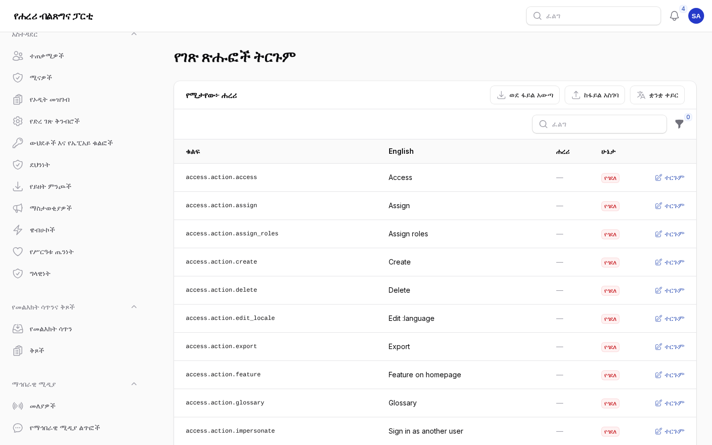
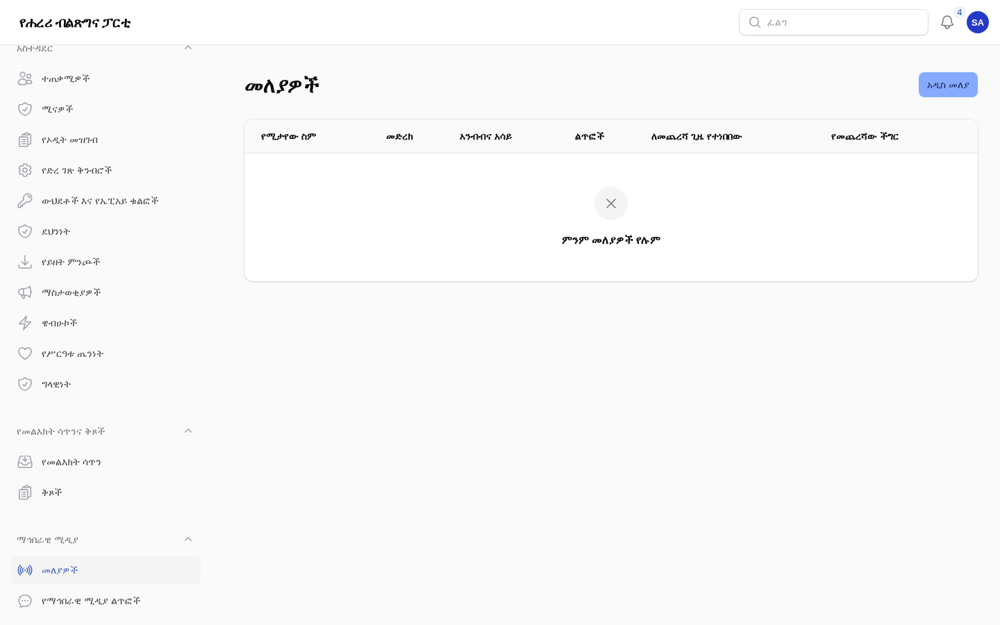

# ትርጉሞችና የማኅበራዊ ሚዲያ ማዕከል

ለሐረሪ ክልል ቅርንጫፍ ጽሕፈት ቤት ተርጓሚዎች፣ የኮሙኒኬሽን ሠራተኞችና የሚዲያ ኃላፊዎች። የእንግሊዝኛው ቅጂ፦
[04-translations-social.md](04-translations-social.md)።

## 1. የድረ ገጹ ቃላት

የድረ ገጹ እያንዳንዱ ቁልፍ፣ ርዕስና መልእክት በእንግሊዝኛ፣ በአማርኛ፣ በአፋን ኦሮሞና በሐረሪ ይገኛል። ተርጓሚዎች
በ**አስተዳደር → ቋንቋዎች → የገጽ ጽሑፎች ትርጉም** ያስተካክሏቸዋል።

ማን፦ የትርጉም መብት ያለው ሁሉ ዝርዝሩን ያያል፤ ተርጓሚ የሚቀይረው የተሰጡትን ቋንቋዎች ብቻ ነው (ለምሳሌ ሐረሪ ብቻ)።

1. ገጹ በእርስዎ ቋንቋ ይከፈታል። **ቋንቋ ቀይር** ይቀይረዋል።
2. የሚሠራውን ለማግኘት **ሁኔታ** ይጠቀሙ፦
   - **የጎደለ**፦ ገና አልተተረጎመም (ድረ ገጹ በምትኩ አማርኛ ወይም እንግሊዝኛ ያሳያል)።
   - **እንግሊዝኛው ተቀይሯል**፦ ይህ ትርጉም ከተሠራ በኋላ የእንግሊዝኛው ጽሑፍ ተቀይሯል።
   - **በማሽን የተተረጎመ**፦ በማሽን የተጻፈ፤ ገና አልተረጋገጠም።
   - **የመፍቻው ቃል ጥቅም ላይ አልዋለም**፦ የጸደቀ ቃል (ክፍል 3ን ይመልከቱ) ጎድሏል።
3. በአንድ መስመር ላይ **ተርጉም** ይምረጡ። የእንግሊዝኛውን ጽሑፍ፣ የሚታይበትን ቦታ፣ ምልክቶቹንና የቅርብ ጊዜ ለውጦችን ያያሉ።
   ጽሑፉን ጽፈው ያስቀምጡ።
4. እንደ `:date` ወይም `:name` ያሉ ምልክቶች እንደ እንግሊዝኛው እንዳሉ መቆየት አለባቸው፤ ድረ ገጹ በቦታቸው እውነተኛውን ቀን
   ወይም ስም ያስገባል። ምልክቶቹ የሌሉበት ጽሑፍ ተቀባይነት አያገኝም።
5. የእርስዎን ቅጂ ለማስወገድ ሳጥኑን ባዶ ይተዉት፤ የተዘጋጀው ጽሑፍ ወይም ተተኪው ቋንቋ እንደገና ይታያል።

እያንዳንዱ ለውጥ ማን እንዳደረገውና ከየትኛው የእንግሊዝኛ ጽሑፍ እንደተሠራ ይመዘገባል።

## 2. በኤክሴል መሥራት

1. በትርጉሞች ገጹ ላይ **ወደ ፋይል አውጣ** ከዚያም **ኤክሴል** ይምረጡ። ፋይሉ `key`፣ `en`፣ የእርስዎ ቋንቋና `context`
   ዓምዶች አሉት።
2. የቋንቋዎን ዓምድ ይሙሉ ወይም ያስተካክሉ። የ`key` ዓምድንና ምልክቶቹን አይቀይሩ።
3. **ከፋይል አስገባ** ይምረጡና ፋይሉን ይምረጡ። ገና ምንም አልተቀመጠም፦ አዲሱን፣ የተቀየረውንና ተቀባይነት ያላገኘውን
   (የማይታወቁ ቁልፎች፣ የተቀየሩ ምልክቶች፣ በUTF-8 ያልተቀመጠ ፋይል) ያያሉ።
4. **እነዚህን ለውጦች አስቀምጥ** ይምረጡ።

**ባዶ ሳጥኖች ትርጉሙን ያስወግዳሉ** የሚለውን ካልመረጡ ባዶ ሳጥኖች ጽሑፉን እንዳለ ይተዉታል።
**አስተዳደር → ቋንቋዎች → የትርጉም ማስገቢያዎች** ሁሉንም ማስገቢያዎች ይዘረዝራል፤ **መልስ** አንዱን ሙሉ በሙሉ ይቀለብሳል።
የግዕዝ ፊደላት እንዳይጠፉ የCSV ፋይሎች በ"CSV UTF-8" መቀመጥ አለባቸው፤ የኤክሴል ፋይሎች ሁልጊዜ ይሠራሉ።

## 3. የቃላት መፍቻ

**አስተዳደር → ቋንቋዎች → የቃላት መፍቻ** ለፓርቲው ስሞች፣ አካላትና ሐሳቦች በየቋንቋው የጸደቁ ቃላትን ከማስታወሻ ጋር ይዟል።
የትርጉም አርታዒው በእያንዳንዱ የእንግሊዝኛ ጽሑፍ ውስጥ ያሉትን ቃላት እና ትርጉምዎ እንደተጠቀመባቸው ያሳያል። የቃላት
መፍቻው ያስጠነቅቃል እንጂ ከማስቀመጥ አያግድም።

## 4. የማሽን ትርጉም

አንድ ዋና አስተዳዳሪ በ**አስተዳደር → ውህደቶች** (Google ወይም የሰው ሰራሽ አስተውሎት ሞዴል) ካላበራው በስተቀር
የማሽን ትርጉም ጠፍቷል። የሚቀርበው ለአማርኛና ለአፋን ኦሮሞ ብቻ ነው፤ ለሐረሪ በፍጹም አይደለም።

- በትርጉሞች ዝርዝር ውስጥ **በማሽን ተርጉም** አንድ መስመር ይሞላል፤ **የጎደሉትን በማሽን ተርጉም** የቋንቋውን የጎደሉ
  መስመሮች በሙሉ ከበስተጀርባ ይሞላል።
- በጽሑፍ ውስጥ የአማርኛና የአፋን ኦሮሞ ትሮች **ከሌላ ቋንቋ በማሽን ተርጉም** ያቀርባሉ።
- ማሽን የጻፈው ሁሉ አንድ ሰው እስኪያረጋግጠው ምልክት ይደረግበታል፦ በዝርዝሩ ውስጥ **እንደተረጋገጠ ምልክት አድርግ** ይምረጡ
  (ወይም ጽሑፉን ያስተካክሉ)፤ በጽሑፍ ውስጥ **በሰው ተረጋግጧል** የሚለውን ምልክት አድርገው ያስቀምጡ።

እያንዳንዱን የማሽን ትርጉም ለሕዝብ ከመታየቱ በፊት ያንብቡ፤ ስሞች፣ ቁጥሮችና የፓርቲው ቃላት የሰው ዓይን ያስፈልጋቸዋል።

## 5. የማኅበራዊ ሚዲያ ማዕከል

ማን፦ የሚዲያ ኃላፊዎች (በአስተዳደሩ ውስጥ **ማኅበራዊ ሚዲያ**)።

- **መለያዎች**፦ የቅርንጫፉ፣ የጽሕፈት ቤቶቹና የሊጎቹ የቴሌግራም ቻናሎች፣ የዩቲዩብ ቻናሎችና የፌስቡክ ገጾች። ቴሌግራምና ዩቲዩብ
  በራሳቸው ይነበባሉ፤ የፌስቡክ ገጽ የገጹን የመዳረሻ ቁልፍ ይፈልጋል (በመለያው ላይ **የገጹ የመዳረሻ ቁልፍ**)። የቲክቶክ፣
  የኢንስታግራምና የኤክስ ልጥፎች በ**ልጥፍ በአድራሻው ጨምር** ይጨመራሉ።
- **አሁን አንብብ** መለያውን ወዲያውኑ ያነባል፤ ያለበለዚያ በየሰዓቱ ይነበባሉ። ስህተቶች ከመለያው አጠገብ ይታያሉ።
- የፌስቡክ ገጽ ቁልፍ ጊዜው ያበቃል፦ **የገጹ የመዳረሻ ቁልፍ** ሜታ እስከ መቼ እንደሚቀበለው ያሳያል፤ የሚዲያ ኃላፊዎች ከ14፣ ከ7
  እና ከ1 ቀን በፊት እንዲሁም መሥራት ሲያቆም ማስጠንቀቂያ ይደርሳቸዋል። አዲሱን ቁልፍ በዚያው ቦታ ያስቀምጡ።
- **የማኅበራዊ ሚዲያ ልጥፎች**፦ የተነበቡ ልጥፎች በሙሉ፣ አዲሱ መጀመሪያ። **ደብቅ** አንዱን ከድረ ገጹ ያርቃል፤ **ከላይ ሰካ**
  አንዱን መጀመሪያ ያቆያል።

የሕዝብ ማዕከሉ በ`/{language}/social` ላይ ነው፤ የመነሻ ገጹ "በማኅበራዊ ሚዲያ" ክፍልና የጽሕፈት ቤቶችና የሊጎች ገጾች
የቅርብ ጊዜ ልጥፎችን ያሳያሉ። ፎቶዎቹ በፖርታሉ ላይ የተቀመጡ ቅጂዎች ሲሆኑ እያንዳንዱ ልጥፍ ወደ መጀመሪያው ይወስዳል።

## ገጾቹ ምን እንደሚመስሉ

የአስተዳደር ክፍሉ ምስሎች ከናሙና ይዘት ጋር (የአስተዳደር ቋንቋ፦ አማርኛ)።

