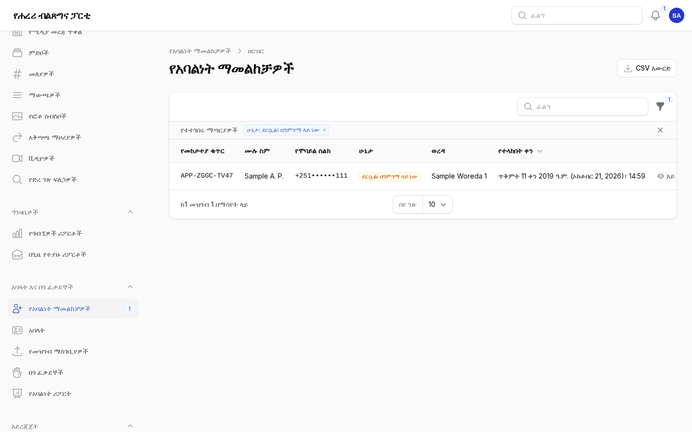
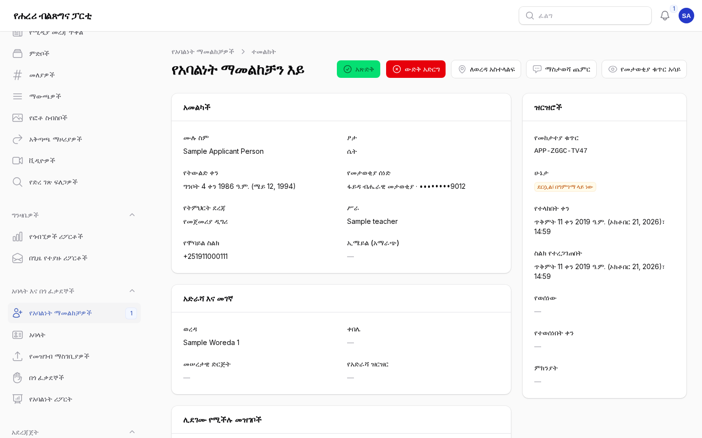
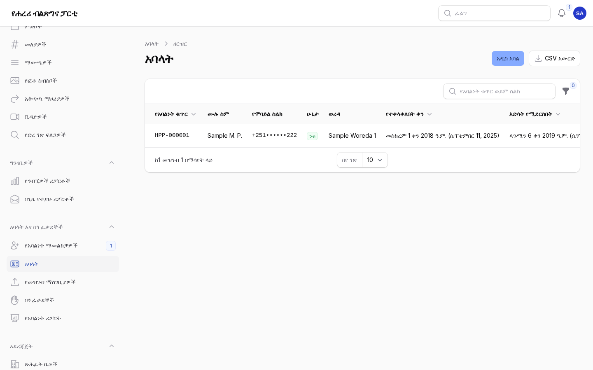
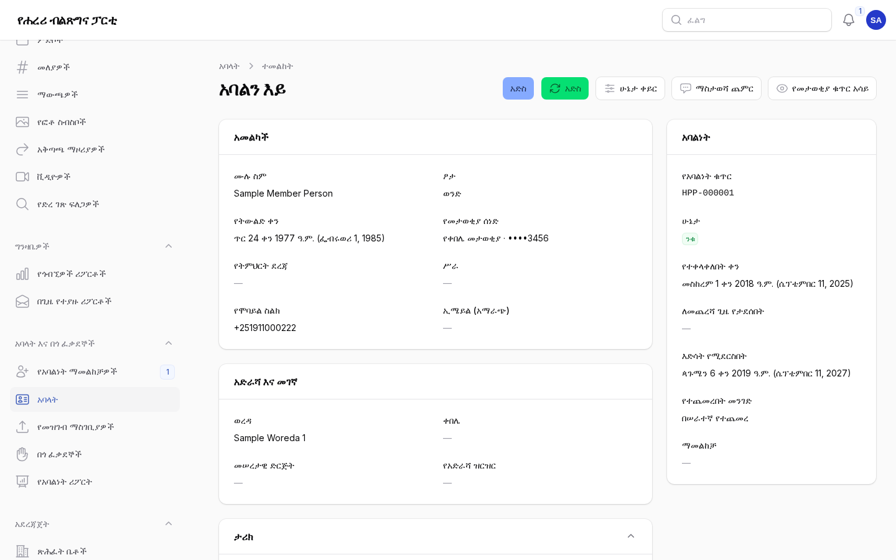
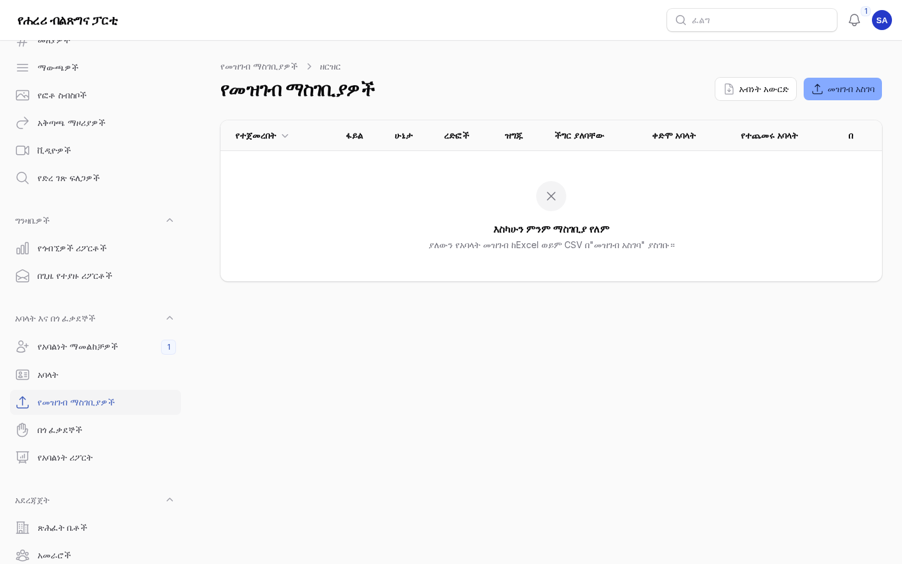
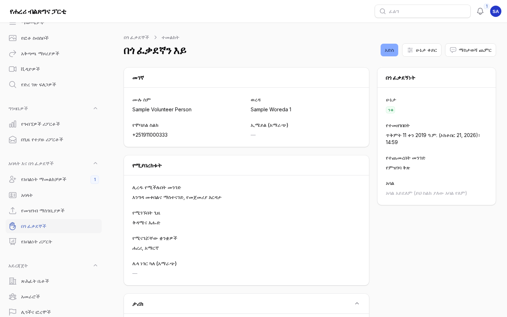
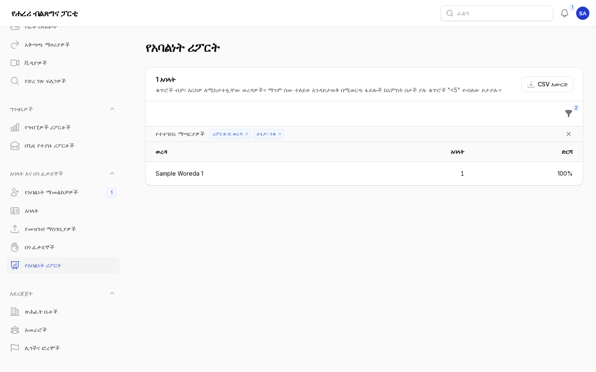
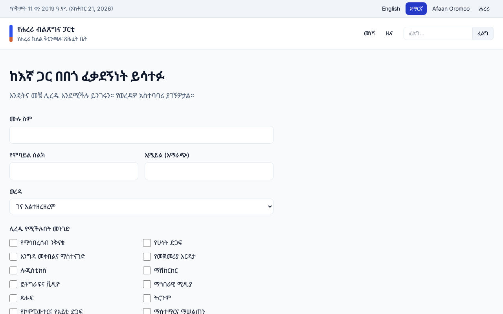
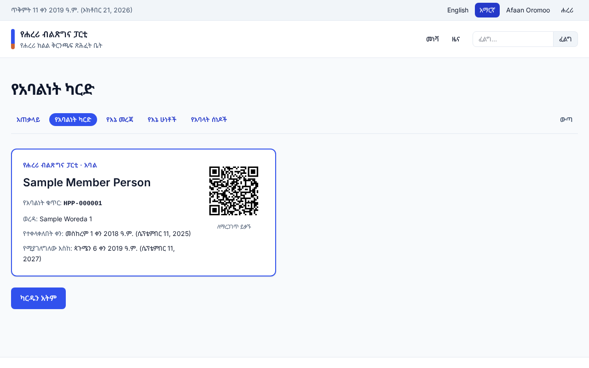

# አባላትና በጎ ፈቃደኞች

ለሐረሪ ክልል ቅርንጫፍ ጽሕፈት ቤት የአባልነት ማመልከቻዎችን፣ የአባላት ማውጫንና በጎ ፈቃደኞችን ለሚያስተዳድሩ ሠራተኞች።
እያንዳንዱ ክፍል ሥራውን ማን ሊያከናውን እንደሚችል ይገልጻል። የእንግሊዝኛው ቅጂ፦
[05-members-volunteers.md](05-members-volunteers.md)።

በዚህ ምዕራፍ ያለው ሁሉ የግል መረጃ ነው። በዝርዝሮች ውስጥ ስሞችና የስልክ ቁጥሮች አጥረው ይታያሉ፤ መዝገብ የሚከፍቱት ሥራዎ
ሲፈልገው ብቻ ይሁን። ለአንዳንድ ወረዳዎች ብቻ የተመደቡ የአባልነት ኃላፊዎች የእነዚያን ወረዳዎች ሰዎች ብቻ ያያሉ። የሚያደርጉት
ሁሉ በመዝገቡ **ታሪክ** እና በኦዲት ምዝግብ ውስጥ ይጻፋል።

## 1. የአባልነት ማመልከቻዎች

ማን፦ የአባልነት ኃላፊዎች (**አባላት እና በጎ ፈቃደኞች → የአባልነት ማመልከቻዎች**)። ከምናሌው አጠገብ ያለው ቁጥር በመጠባበቅ ላይ
ያሉ ማመልከቻዎች ብዛት ነው።

ሰዎች በ`/{language}/membership/apply` በሦስት ደረጃዎች ያመለክታሉ፤ ስልካቸውን በአጭር የጽሑፍ መልእክት በሚላክ ባለ ስድስት
አሃዝ ኮድ ያረጋግጣሉ። ማመልከቻው ወደ ዝርዝሩ የሚደርሰው ከዚያ በኋላ ብቻ ሲሆን እንደ `APP-7K3D-9Q2M` ያለ የመከታተያ
ቁጥር ይሰጠዋል፤ ሰውየውም በ`/{language}/membership/status` ሊከታተለው ይችላል።

1. ዝርዝሩ **ደርሷል፤ በግምገማ ላይ ነው** በሚለው ይጀምራል። ለሌሎች ሁኔታዎች ወይም ለአንድ ወረዳ ማጣሪያዎቹን ይጠቀሙ።
2. ማመልከቻ ይክፈቱ። የመታወቂያ ቁጥሩ የመጨረሻዎቹን አራት አሃዞች ብቻ ያሳያል፤ **የመታወቂያ ቁጥር አሳይ** የሚለውን
   የሚመርጡት ከሰነዱ ጋር ለማመሳከር ብቻ ይሁን። እያንዳንዱ እይታ ይመዘገባል።
3. **ሊደገሙ የሚችሉ መዝገቦች** የሚለውን ይመልከቱ፦ ተመሳሳይ የመታወቂያ ቁጥር፣ ስልክ፣ ኢሜይል ወይም ስምና የትውልድ ቀን
   ያላቸው ሌሎች ማመልከቻዎች ወይም አባላት። ሰውየው ቀድሞ አባል ከሆነ ማመልከቻውን ውድቅ አድርገው ምክንያቱን ይጻፉ።
4. **አጽድቅ** ይምረጡ፦ ሰውየው ቀጣዩን የአባልነት ቁጥር (`HPP-000123`) ይዞ አባል ይሆናል፣ እድሳቱ በ12 ወራት ይደርሳል፣
   በአጭር የጽሑፍ መልእክትም (ኢሜይል ከሰጠ በኢሜይልም) ይነገረዋል።
5. ወይም **ውድቅ አድርግ** ይምረጡና ምክንያቱን ይጻፉ። ሰውየው በሁኔታ መከታተያ ገጹ ላይ ያየዋል፤ መልእክትም ይደርሰዋል።
6. ሰውየው በሌላ ወረዳ የሚኖር ከሆነ **ለወረዳ አስተላልፍ** ይምረጡ፦ የዚያ ወረዳ ኃላፊዎች በዝርዝራቸው ያዩታል።
   ባልደረቦች ሊያውቁት የሚገባ ነገር ካለ **ማስታወሻ ጨምር** ይጠቀሙ።

**CSV አውርድ** በማያ ገጹ ላይ ያሉትን ማመልከቻዎች (ከማጣሪያዎችዎ ጋር) ያለ መታወቂያ ቁጥሮች ይሰጣል።

## 2. አባላት

ማን፦ የአባልነት ኃላፊዎች (**አባላት እና በጎ ፈቃደኞች → አባላት**)።

- በ**የአባልነት ቁጥር** ወይም በ**ስልክ ቁጥር** ይፈልጉ። ስሞች ተመስጥረው ስለሚቀመጡ በስም መፈለግ አይቻልም።
- ማጣሪያዎች፦ ሁኔታ፣ ወረዳ፣ በ30 ቀናት ውስጥ የሚደርስ ወይም ጊዜው ያለፈ እድሳት (በቀይ ይታያል)።
- **አዲስ አባል** በወረቀት የተቀላቀለን ሰው ይጨምራል። የተቀላቀለበትን ቀን ይስጡ፤ የመጀመሪያው እድሳት የዚያ ቀን ቀጣይ
  ዓመታዊ መታሰቢያ ነው። ተመሳሳይ የመታወቂያ ቁጥር ያለው ሁለተኛ አባል አይቀበልም።
- **አስተካክል** መረጃዎችን ያርማል። የመታወቂያ ቁጥሩ ሳጥን ባዶ ሆኖ ይቆያል፤ ቁጥር የሚጽፉት ለመተካት ብቻ ነው። ታሪኩ
  የተቀየሩትን መረጃዎች ይዘረዝራል እንጂ የቀድሞዎቹን እሴቶች አያሳይም።
- **አድስ** አባልነቱን ከሚደርስበት ቀን (ቀኑ ካለፈ ደግሞ ከዛሬ) ጀምሮ በ12 ወራት ያራዝማል።
- **ሁኔታ ቀይር** (ንቁ፣ ጊዜው ያለፈበት፣ የታገደ፣ የለቀቀ፣ ያረፈ) ምክንያት ይፈልጋል።
- አባላት እድሳታቸው ከመድረሱ 30 ቀናት በፊት አንድ መልእክት ይደርሳቸዋል። ከ90 ቀናት በላይ ጊዜው ያለፈበት አባልነት
  በራሱ **ጊዜው ያለፈበት** ይሆናል፤ ማደስ እንደገና ንቁ ያደርገዋል።

ከአባላት ፖርታል እርማት የጠየቀ አባል በ**ታሪክ** ውስጥ "እርማት ተጠይቋል" ተብሎ ይታያል፤ ማሳወቂያም ይደርስዎታል።
ጥያቄውን አረጋግጠው መዝገቡን ራስዎ ያስተካክሉ።

## 3. ያለውን መዝገብ ማስገባት

ማን፦ አባላትን ማስገባት የተፈቀደላቸው ሠራተኞች (**አባላት እና በጎ ፈቃደኞች → የመዝገብ ማስገቢያዎች**)።

1. የExcel (.xlsx) ወይም የCSV ፋይል ያዘጋጁ፦ በአንድ ረድፍ አንድ አባል፣ የአምድ ርዕሶቹ በመጀመሪያው ረድፍ፣ ቢበዛ 5,000
   ረድፎች። **አብነት አውርድ** የተለመዱትን ርዕሶች ይሰጣል። የኢትዮጵያ ፊደላት እንዲጠበቁ የCSV ፋይሎችን በUTF-8 ያስቀምጡ።
2. **መዝገብ አስገባ** ይምረጡና ፋይሉን ይጫኑ።
3. እያንዳንዱን መረጃ ከአምድ ጋር ያዛምዱ (ሊሆኑ የሚችሉት ቀድመው ተመርጠዋል)። ቁጥሮቹ የየትኛው የመታወቂያ ሰነድ እንደሆኑ፣
   የተጻፉት ቀኖች የኢትዮጵያ ወይም የግሪጎሪያን መሆናቸውን፣ ቀን ለሌላቸው ረድፎችም የተቀላቀሉበትን ቀን ይግለጹ።
4. **ፋይሉን ፈትሽ** ይምረጡ። እስካሁን ምንም አልተጨመረም። ገጹ ችግሮቹን በረድፍ ቁጥር ይዘረዝራል፦ የጎደለ ስም፣ የማይታወቅ
   የወረዳ ስም፣ የሞባይል ያልሆነ ስልክ፣ ከ18 ዓመት በታች የሆነ ሰው፣ ቀድሞ የአንድ አባል የሆነ ወይም ሁለት ጊዜ የተጻፈ
   የመታወቂያ ቁጥር። ካስፈለገ ፋይሉን አርመው እንደገና ያስገቡ።
5. **… አባላትን ጨምር** ይምረጡ። አባላቱ በጥቂት ደቂቃዎች ውስጥ ከበስተጀርባ ይጨመራሉ፤ እያንዳንዳቸው አዲስ የአባልነት ቁጥርና
   በቀድሞው መዝገብ የነበራቸውን ቁጥር የሚገልጽ ማስታወሻ ያገኛሉ።
6. ማስገቢያው ስህተት ከሆነ በ30 ቀናት ውስጥ **መልስ** የጨመራቸውን አባላት ያስወግዳል።

## 4. በጎ ፈቃደኞች

ማን፦ በጎ ፈቃደኞችን የሚያስተባብሩ ሠራተኞች (**አባላት እና በጎ ፈቃደኞች → በጎ ፈቃደኞች**)።

ሰዎች በ`/{language}/volunteer` ችሎታቸውን፣ የሚገኙበትን ጊዜና የሚናገሯቸውን ቋንቋዎች በመግለጽ ለመርዳት ይመዘገባሉ።
በወረዳዎችዎ ለሚደረግ እያንዳንዱ ምዝገባ ማሳወቂያ ይደርስዎታል፤ ዝርዝሩም የ**አዲስ** ምዝገባዎችን ብዛት ያሳያል።

1. ሰውየውን ደውለው ያነጋግሩ፣ ከዚያ ገጹን ይክፈቱ። በአንድ ሁነት ላይ (ተግባሩ የሁነቱን ስምና ቀን ይወስዳል) ወይም ራሱን
   የቻለ **ተግባር ጨምር**። የመጀመሪያው ተግባር አዲስ በጎ ፈቃደኛን **ንቁ** ያደርገዋል።
2. ከተግባሩ በኋላ በተሰጡት ሰዓቶች **አዘምን** በማለት **ተከናውኗል** ያድርጉት። ሰዓቶቹ በዝርዝሩ ላይ ይደመራሉ።
3. አንድ ሰው በበጎ ፈቃደኝነት መሳተፍ ሲያቆም **ሁኔታ ቀይር** በማለት **ንቁ ያልሆነ** ያድርጉት። ተግባራት ይሰረዛሉ እንጂ
   አይጠፉም።
4. የበጎ ፈቃደኛው ስልክ የአንድ አባልም ከሆነ ገጹ የአባልነት ቁጥሩን ያሳያል።

ማንም ያልተከታተላቸው ምዝገባዎች ከአንድ ዓመት በኋላ ይሰረዛሉ።

## 5. የአባላት ፖርታል

አባላት በ`/{language}/member/sign-in` በመዝገባቸው ላይ ባለው የስልክ ቁጥርና በአጭር የጽሑፍ መልእክት በሚላክ ኮድ ይገባሉ።
እዚያ አባልነታቸውን፣ የሚታተም **የአባልነት ካርድ** ከQR ኮድ ጋር፣ መረጃቸውን (እርማት የሚጠይቁበት ቅጽ ጨምሮ)፣ የሁነት
ምዝገባዎቻቸውንና **የአባላት ሰነዶችን** ያያሉ።

- ሰነድ ለአባላት ብቻ ለማጋራት በ**ሰነዶች** ውስጥ **ማን ሊያየው ይችላል** የሚለውን **አባላት ብቻ** ያድርጉ። ከዚያ በኋላ
  በሕዝብ ድረ ገጹ ላይ ፈጽሞ አይታይም።
- የካርዱን QR ኮድ የሚቃኝ ማንኛውም ሰው አባልነቱ በመልካም አቋም ላይ መሆኑን፣ ቁጥሩን፣ የስሙን የመጀመሪያ ፊደላትና ወረዳውን
  ብቻ ያያል።
- በመዝገቡ ላይ የስልክ ቁጥር የሌለው አባል እርስዎ ቁጥር እስኪጨምሩ ድረስ መግባት አይችልም።

## 6. ሪፖርቶችና የግል መረጃ ጥበቃ

- ዳሽቦርዱ **አባላትና በጎ ፈቃደኞች** (ንቁ አባላት፣ የተቀላቀሉ አባላት፣ በመጠባበቅ ላይ ያሉ ማመልከቻዎች፣ በጎ ፈቃደኞችና
  ሰዓቶች) እና **ማመልከቻዎችና አባላት** (የማመልከቻዎቹ ሂደት፣ አባላት በወረዳ፣ በፆታና በዕድሜ) ያሳያል።
- **የአባልነት ሪፖርት** አባላትን በወረዳ፣ በፆታ፣ በዕድሜ፣ በሁኔታ፣ በተጨመሩበት መንገድ ወይም በተቀላቀሉበት ወር ይቆጥራል።
  ማንም ተለይቶ እንዳይታወቅ በሚወርዱ ፋይሎች ከአምስት በታች ያሉ ቁጥሮች "<5" ተብለው ይታያሉ።
- አንድ ሰው ፖርታሉ ስለ እርሱ የያዘውን ሲጠይቅ ወይም እንዲሰረዝ ሲጠይቅ **አስተዳደር → ግላዊነት** ይጠቀሙ
  (ምዕራፍ 1)፦ ማመልከቻዎች፣ የአባል መዝገቦችና የበጎ ፈቃደኛ ምዝገባዎች በኢሜይል ወይም በስልክ ተፈልገው ይገኛሉ፣ ቅጂ
  ይሰጣል ወይም ይሰረዛሉ።

## ገጾቹ ምን እንደሚመስሉ

የአስተዳደር ክፍሉ ምስሎች ከናሙና ይዘት ጋር (የአስተዳደር ቋንቋ፦ አማርኛ)።

