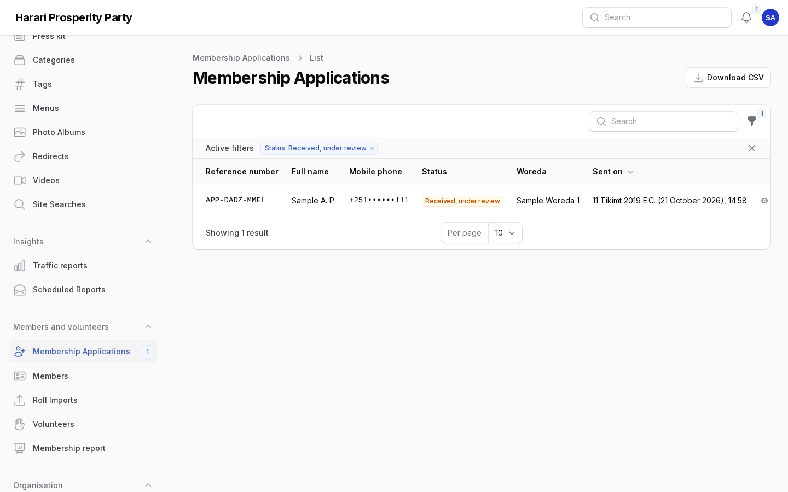
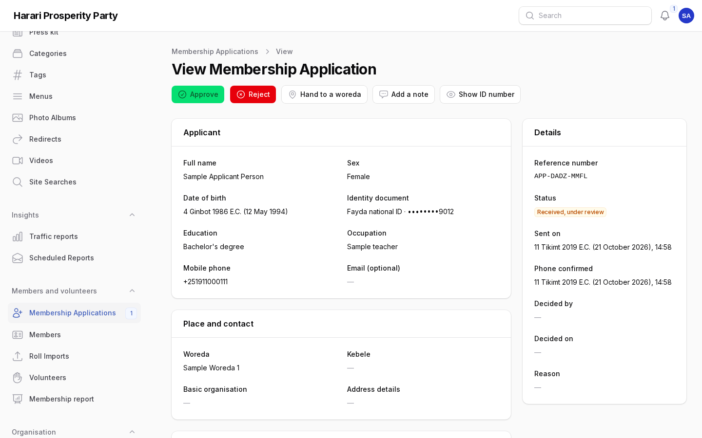
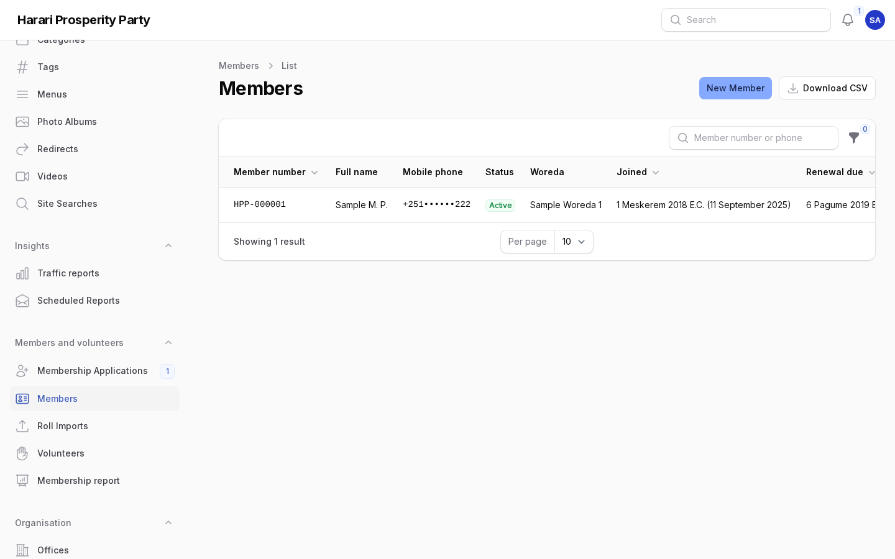
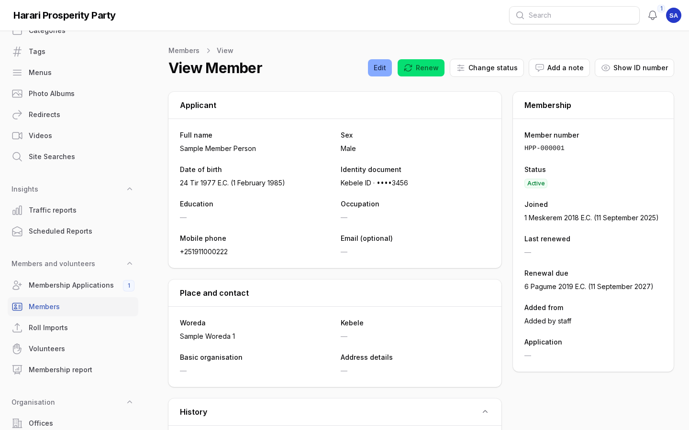
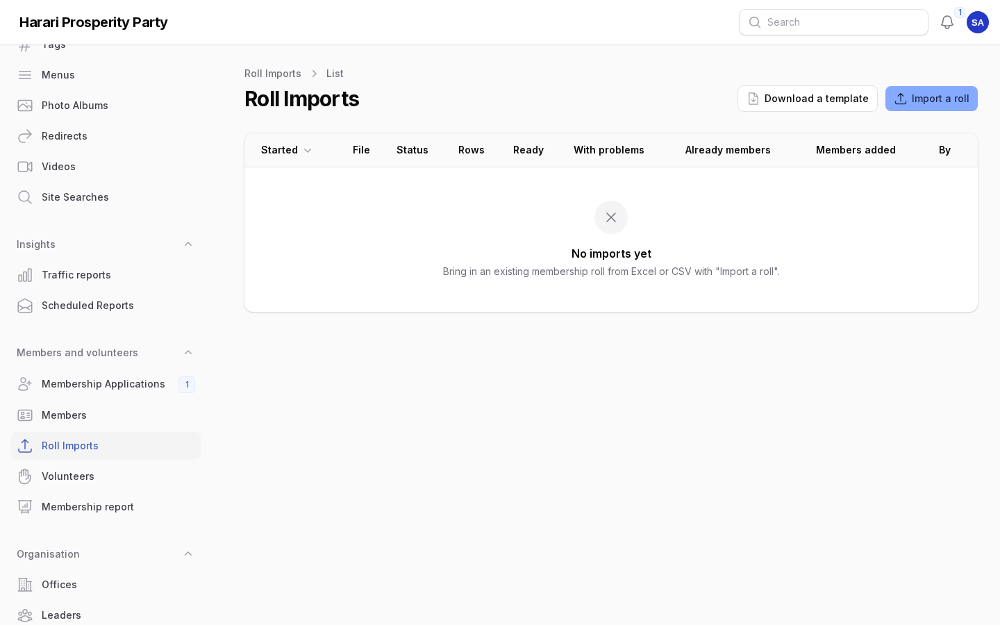
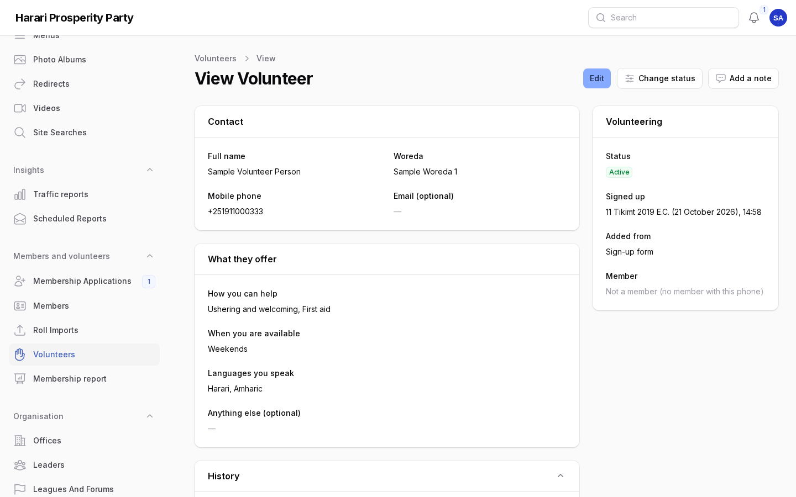
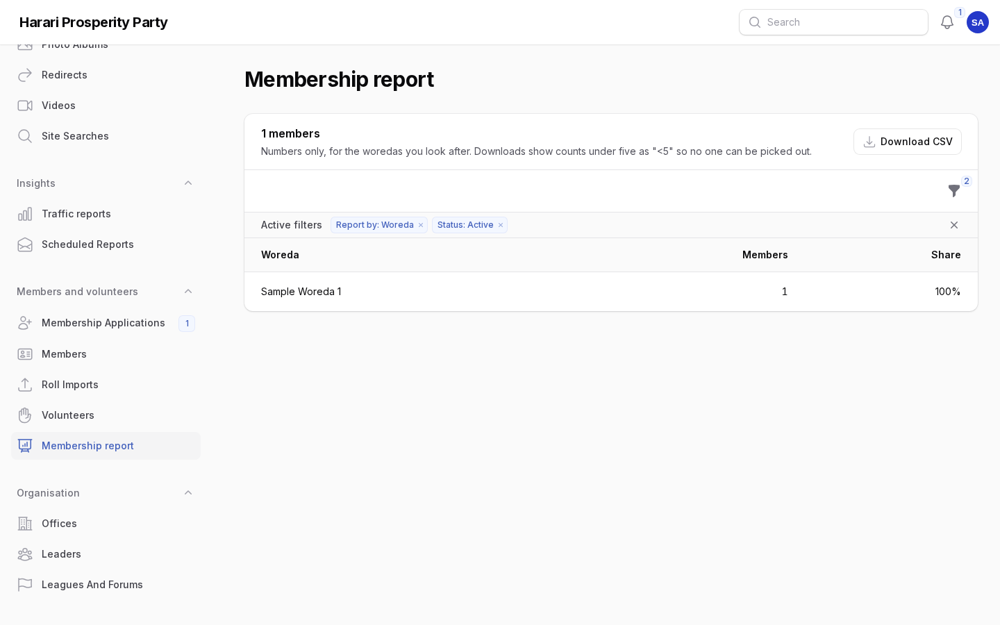
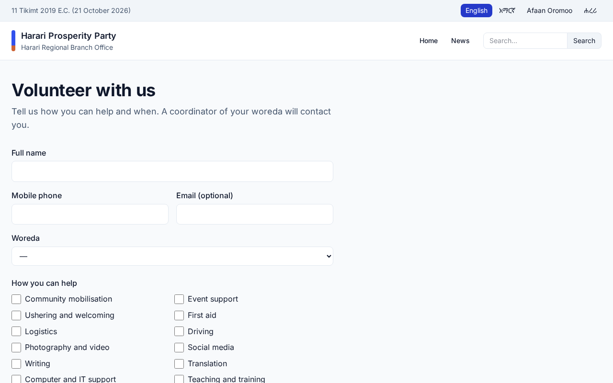
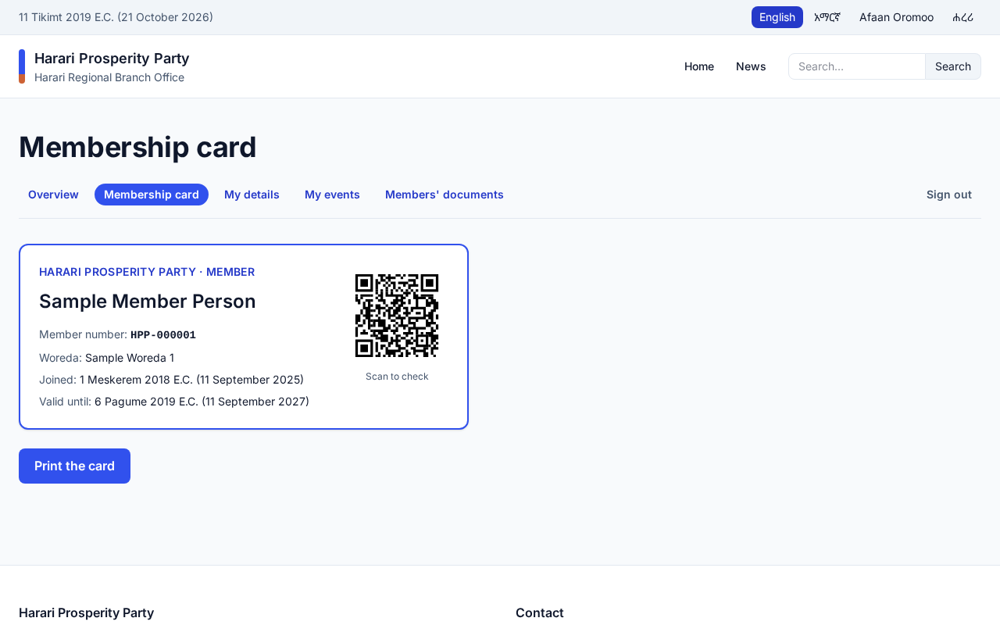

# Members and volunteers

For staff of the Harari Regional Branch Office who handle membership applications, the members directory
and volunteers. Each section says who may do it. Amharic version:
[05-members-volunteers.am.md](05-members-volunteers.am.md).

Everything in this chapter is personal data. Names and phone numbers are shortened in lists; open a record
only when your work needs it. Membership officers who are limited to some woredas see only the people of
those woredas. Everything you do is written in the record's **History** and in the audit log.

## 1. Membership applications

Who: membership officers (**Members and volunteers → Membership Applications**). The number next to the
menu item is the number of applications waiting.

People apply at `/{language}/membership/apply` in three steps and confirm their phone with a six-digit code
by SMS. Only then does the application reach the queue, with a reference such as `APP-7K3D-9Q2M` that the
person can use to follow it at `/{language}/membership/status`.

1. The list starts with **Received, under review**. Use the filters for other statuses or a woreda.
2. Open an application. The ID number shows its last four digits; choose **Show ID number** only to compare
   it with the document. Each look is recorded.
3. Check **Possible duplicates**: other applications or members with the same ID number, phone, email, or
   name and date of birth. If the person is already a member, reject the application and say so.
4. Choose **Approve**: the person becomes a member with the next member number (`HPP-000123`), the renewal
   is due in 12 months, and they receive an SMS (and an email if they gave one).
5. Or choose **Reject** and write the reason. The person sees it on the status page and receives an SMS.
6. If the person lives in another woreda, choose **Hand to a woreda**: the officers of that woreda see it in
   their queue. **Add a note** for anything colleagues should know.

**Download CSV** gives the applications on screen (with your filters) without ID numbers.

## 2. Members

Who: membership officers (**Members and volunteers → Members**).

- Search by **member number** or **phone number**. Names cannot be searched, because they are stored
  encrypted.
- Filters: status, woreda, renewal due within 30 days or overdue (shown in red).
- **New member** adds someone who joined on paper. Give the date they joined; the first renewal is the next
  anniversary of that date. A second member with the same ID number is refused.
- **Edit** corrects details. The ID number field stays empty: type a number only to replace it. The history
  lists which details changed, never the old values.
- **Renew** extends the membership by 12 months from the due date (or from today if it has passed).
- **Change status** (active, lapsed, suspended, resigned, deceased) needs a reason.
- Members receive one SMS 30 days before their renewal is due. Memberships 90 days overdue become
  **lapsed** automatically; renewing makes them active again.

A member who asks the portal for a correction appears in **History** as "Correction requested", and you
get a notice. Check the request, then edit the record yourself.

## 3. Importing an existing roll

Who: staff allowed to import members (**Members and volunteers → Roll Imports**).

1. Prepare an Excel (.xlsx) or CSV file: one member per row, column headings in the first row, at most 5,000
   rows. **Download a template** gives the usual headings. Save CSV files as UTF-8 so Ethiopic letters stay.
2. Choose **Import a roll** and upload the file.
3. Match each detail to a column (the likely ones are already chosen). Say which ID document the numbers
   are, whether typed dates are Ethiopian or Gregorian, and the joining date for rows without one.
4. Choose **Check the file**. Nothing is added yet. The page lists the problems by row number: a missing
   name, an unknown woreda name, a phone that is not a mobile number, someone under 18, an ID number that is
   already a member's or appears twice. Fix the file if needed and import it again.
5. Choose **Add … members**. The members are added in the background within a few minutes, each with a new
   member number and a note of their number in the old roll.
6. If the import was a mistake, **Roll back** within 30 days removes the members it added.

## 4. Volunteers

Who: staff who coordinate volunteers (**Members and volunteers → Volunteers**).

People offer help at `/{language}/volunteer`: skills, when they are available and the languages they speak.
You get a notice for each sign-up in your woredas; the list shows a number for **New** sign-ups.

1. Call the person, then open their page. **Add a task** at an event (the task takes the event's name and
   date) or on its own. The first task makes a new volunteer **Active**.
2. After the task, **Update** it to **Done** with the hours given. The hours are added up on the list.
3. **Change status** to **Inactive** when someone stops volunteering. Tasks are cancelled, never deleted.
4. If the volunteer's phone is also a member's, the page shows their member number.

Sign-ups nobody followed up are deleted after a year.

## 5. Member portal

Members sign in at `/{language}/member/sign-in` with the phone number on their record and a code by SMS.
There they see their membership, a **membership card** to print with a QR code, their details (with a form to
ask for corrections), their event registrations and the **members' documents**.

- To share a document with members only, set **Who may see it** to **Members only** in **Documents**.
  It is then never shown on the public site.
- Anyone who scans the card's QR code sees whether the membership is in good standing, the number, the
  initials and the woreda, nothing more.
- A member without a phone number on file cannot sign in until you add one.

## 6. Reports and privacy

- The dashboard shows **Members and volunteers** (active members, members who joined, applications waiting,
  volunteers and hours) and **Applications and members** (the application funnel, members by woreda, sex and
  age band).
- **Membership report** counts members by woreda, sex, age, status, how they were added or the month they
  joined. Downloads show counts under five as "<5" so no one can be picked out.
- When someone asks what the portal holds about them, or asks for it to be deleted, use **Administration →
  Privacy** (chapter 1): applications, member records and volunteer sign-ups are found by email or
  phone, copied or erased.

## Screens

Screenshots of the admin with sample content (English admin language).

