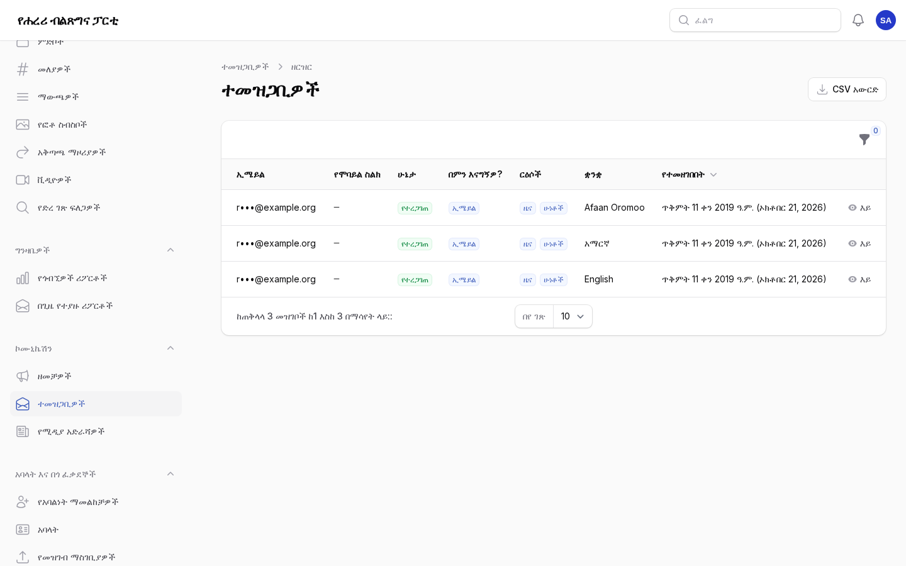
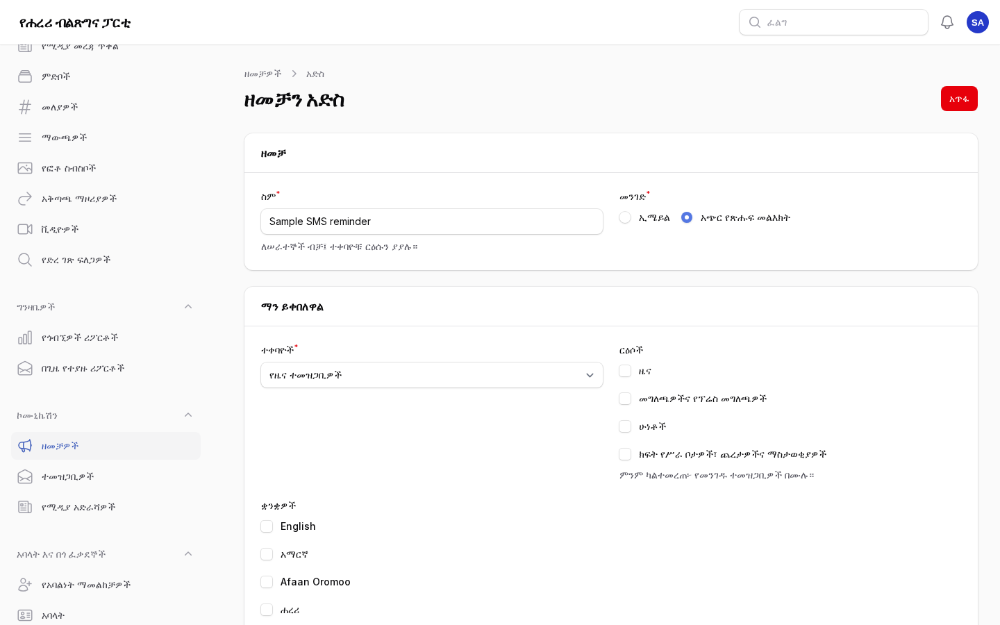
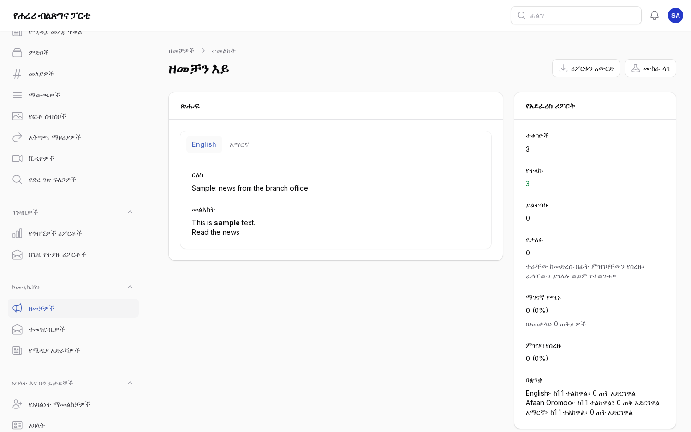
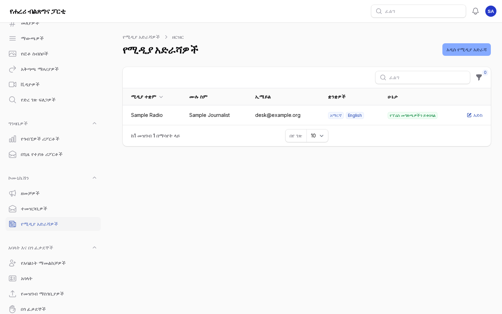
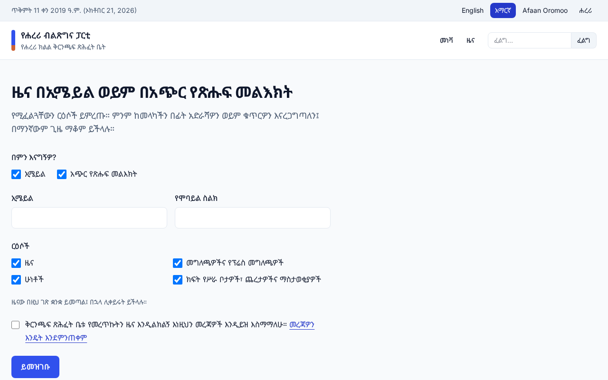

# ኮሙኒኬሽን፦ የዜና መጽሔት፣ ዘመቻዎች፣ ሚዲያና ቴሌግራም

ለሐረሪ ክልል ቅርንጫፍ ጽሕፈት ቤት ዜናን በኢሜይልና በአጭር የጽሑፍ መልእክት ለሚልኩ፣ የሚዲያ ዝርዝሩን ለሚይዙና ማሳወቂያዎችን
በቴሌግራም ለሚቀበሉ ሠራተኞች። እያንዳንዱ ክፍል ሥራውን ማን ሊያከናውን እንደሚችል ይገልጻል። የእንግሊዝኛው ቅጂ፦
[06-communication.md](06-communication.md)።

የቅርንጫፍ ጽሕፈት ቤቱ የኢሜይልና የአጭር መልእክት መለያዎች እስኪዘጋጁ ድረስ ኢሜይሎች ወደ አገልጋዩ የኢሜይል ምዝግብ፣ አጭር
መልእክቶችም ወደ አጭር መልእክት ምዝግቡ ይሄዳሉ፤ ስለዚህ ከሙከራ ድረ ገጹ ምንም ነገር ለእውነተኛ ሰዎች አይደርስም።

## 1. ተመዝጋቢዎች

ማን፦ የኮሙኒኬሽን ሠራተኞች (**ኮሙኒኬሽን → ተመዝጋቢዎች**)።

ሰዎች ራሳቸው በ`/{language}/newsletter` ወይም በእያንዳንዱ ገጽ ግርጌ ባለው የኢሜይል ሳጥን ይመዘገባሉ። ኢሜይል፣ አጭር
የጽሑፍ መልእክት ወይም ሁለቱንም፣ እንዲሁም ርዕሶችን ይመርጣሉ፦ ዜና፤ መግለጫዎችና የፕሬስ መግለጫዎች፤ ሁነቶች፤ ክፍት የሥራ
ቦታዎች፣ ጨረታዎችና ማስታወቂያዎች። የኢሜይል አድራሻ በማገናኛ፣ ስልክ ደግሞ ባለ ስድስት አሃዝ ኮድ ይረጋገጣል፤ እስከዚያ ድረስ
ምንም አይላክላቸውም። የሚደርሳቸው እያንዳንዱ ኢሜይል ወደ ምርጫዎቻቸው ይወስዳል፤ እዚያ ርዕሶችን፣ ቋንቋን፣ መንገዶችን
ይቀይራሉ ወይም ሁሉንም ያቆማሉ።

- ዝርዝሩ አድራሻዎችንና ቁጥሮችን አሳጥሮ ያሳያል። በሁኔታ (የተረጋገጠ፣ ማረጋገጫ በመጠባበቅ ላይ፣ ምዝገባ የሰረዘ)፣ በመንገድ፣
  በርዕስ ወይም በቋንቋ ያጣሩ።
- በተመዝጋቢው ገጽ ላይ ያለው **ሁሉንም ዜና አቁም** በስልክ ወይም በደብዳቤ ለጠየቀ ሰው ነው። ሠራተኞች ተመዝጋቢዎችን ፈጽሞ
  አይጨምሩም፤ ሰዎች ራሳቸው ይመዘገባሉ።
- **CSV አውርድ** ተመዝጋቢዎችን ማውጣት ለተፈቀደላቸው ሠራተኞች ነው፤ እያንዳንዱ ማውረድ በኦዲት ምዝግቡ ይመዘገባል።
- ፈጽሞ ያልተረጋገጡ ምዝገባዎች ከአንድ ሳምንት በኋላ ይሰረዛሉ።

## 2. ዘመቻዎች

ማን፦ የኮሙኒኬሽን ሠራተኞች ዘመቻዎችን ይጽፋሉ፤ ዘመቻ መላክ የተፈቀደላቸው ይልካሉ (**ኮሙኒኬሽን → ዘመቻዎች**)።

1. አዲስ ዘመቻ፦ ለሠራተኞች የሚሆን ስም፣ መንገዱ (ኢሜይል ወይም አጭር የጽሑፍ መልእክት) እና ተቀባዮቹ፦
   - **የዜና ተመዝጋቢዎች**፣ ከተፈለገ የተወሰኑ ርዕሶች ወይም ቋንቋዎች ብቻ፤
   - **አባላት**፣ በወረዳና በሁኔታ (አባላትን ማየት ለሚችሉ ሠራተኞች ብቻ፣ ለሚከታተሏቸው ወረዳዎች)፤
   - **ንቁ በጎ ፈቃደኞች**፣ በወረዳ (በጎ ፈቃደኞችን ማየት ለሚችሉ ሠራተኞች ብቻ)።
2. በሚችሉት ቋንቋ ሁሉ ጽሑፉን ይጻፉ። ሰዎች በራሳቸው ቋንቋ፣ ወይም ከጻፉት ቋንቋ በጣም በሚቀርበው ይቀበላሉ (የሐረሪ አንባቢዎች
   አማርኛ፣ ከዚያም እንግሊዝኛ ያገኛሉ)። ኢሜይል ርዕስና መልእክት (ደማቅ ጽሑፍ፣ ማገናኛዎች፣ ዝርዝሮች) አለው፤ አጭር መልእክት
   የማቆሚያ ማገናኛውን ጨምሮ ርዝመቱንና የክፍሎቹን ብዛት ያሳያል፤ ቢበዛ አራት ክፍሎች።
3. ያስቀምጡ። ገጹ ዘመቻው አሁን ስንት ሰዎችን እንደሚደርስ ያሳያል።
4. **ሙከራ ላክ**፦ ወደ ራስዎ ኢሜይል፣ ወይም ወደሚጽፉት የስልክ ቁጥር፣ በሚመርጡት ቋንቋ።
5. **አሁን ላክ**፣ ወይም በተወሰነ ቀንና ሰዓት **በኋላ ላክ**። ቀጠሮ የተያዘለት ዘመቻ **ወደ ረቂቅ መልስ** ሊባል ይችላል፤ በመላክ ላይ
   ያለውን **መላክ አቁም** ይቻላል። ከተላከ በኋላ ዘመቻው ሊቀየር አይችልም።

መልእክቶቹ በደቂቃ በሚፈቀደው ብዛት ይላካሉ። እያንዳንዱ ኢሜይል ለምን እንደደረሰ ይገልጻል፤ እነዚህን መልእክቶች ለማቆም
ማገናኛም አለው፤ እያንዳንዱ አጭር መልእክት "ለማቆም፦ <ማገናኛ>" በሚል ያበቃል። እነዚህን ያቆመ አባል ወይም በጎ ፈቃደኛ ስለራሱ
አባልነት የሚላኩ መልእክቶችን መቀበሉን ይቀጥላል።

### የአደራረስ ሪፖርት

የዘመቻው ገጽ ስንቶቹ እንደተላኩ፣ ገና የሚላኩ፣ ያልተሳኩ፣ የታለፉ (ሰውየው ተራው ከመድረሱ በፊት የወጣ)፣ በኢሜይሉ ውስጥ ያለ
ማገናኛ የጫኑና ምዝገባ የሰረዙትን ከቋንቋ ቁጥሮች ጋር ያሳያል። **ሪፖርቱን አውርድ** ያለ ምንም አድራሻ ለእያንዳንዱ ተቀባይ አንድ
መስመር ይሰጣል። ዳሽቦርዱ **የዘመቻ ውጤቶች** እና **ተመዝጋቢዎች** ያሳያል።

የአገልጋዩ መቼት `PORTAL_CAMPAIGN_OPEN_TRACKING` ካልበራ ኢሜይል መከፈቱ አይቆጠርም፤ ብዙ የኢሜይል መተግበሪያዎች ለዚህ
የሚውለውን የማይታይ ምስል ያግዳሉ፤ ሰዎችንም ሳይጠይቅ ይቆጥራል።

## 3. የሚዲያ አድራሻዎችና የፕሬስ መግለጫዎች

ማን፦ የኮሙኒኬሽን ሠራተኞች (**ኮሙኒኬሽን → የሚዲያ አድራሻዎች**)።

1. አዲስ የሚዲያ አድራሻ፦ ስም፣ ሚዲያ ተቋም፣ የሥራ መደብ፣ ኢሜይል፣ ስልክና የሚቀበሏቸው ቋንቋዎች በምርጫ ቅደም ተከተል፣
   ለሠራተኞች ማስታወሻ ጋር።
2. የፕሬስ መግለጫ፣ መግለጫ ወይም ንግግር እንደተለመደው ያትሙ። በማስተካከያ ገጹ ላይ **ወደ ሚዲያ ላክ** ይምረጡ፦ ለሁሉም
   አድራሻዎች ወይም ለመረጧቸው ብቻ። እያንዳንዱ ርዕሱን፣ ማጠቃለያውንና ወደ ሙሉው ጽሑፍ የሚወስድ ማገናኛ ከቋንቋዎቹ ውስጥ
   ጽሑፉ በታተመበት በመጀመሪያው ይቀበላል።
3. የጽሑፉ **ወደ ሚዲያ የተላከ** ትር እያንዳንዱን አድራሻ፣ ቋንቋውን፣ መላኩን፣ መቼና በማን እንደተላከ ይዘረዝራል።

እያንዳንዱ የፕሬስ ኢሜይል መቀበል ለማቆም ማገናኛ አለው፤ ከዚያ አድራሻው "ራሱን አግልሏል" ተብሎ ይታያል።

## 4. ማሳወቂያዎች በቴሌግራም

የቅርንጫፍ ጽሕፈት ቤቱ የፖርታሉን የቴሌግራም ቦት ፈጥሮ ቶከኑን በ**መቼቶች → ውህደቶች** ካስቀመጠ (እና ዌብሁኩ ከተመዘገበ፣
የአገልጋዩን መመሪያ ይመልከቱ) በኋላ፦

1. **ማሳወቂያዎች**ን ከፍተው **ቴሌግራም አገናኝ** ይምረጡ።
2. ቴሌግራም በሚጠቀሙበት ስልክ ላይ ማገናኛውን ከፍተው **Start** ይጫኑ። ቦቱ ያረጋግጣል።
3. በ**ማሳወቂያ የሚደርሰኝ መንገድ** ውስጥ እዚያ ለሚፈልጓቸው የማሳወቂያ ዓይነቶች **ቴሌግራም** ይምረጡ።

ለማቆም ለቦቱ `/stop` ይላኩ ወይም **ቴሌግራም አለያይ** ይምረጡ።

## 5. ግላዊነት

**አስተዳደር → ግላዊነት** የዜና ምዝገባዎችንና የሚዲያ አድራሻዎችንም በኢሜይል ወይም በስልክ ፈልጎ ያገኛል፤ ሲጠየቅ ቅጂ ይሰጣል፣
ይሰርዛልም።

## ገጾቹ ምን እንደሚመስሉ

የአስተዳደር ክፍሉ ምስሎች ከናሙና ይዘት ጋር (የአስተዳደር ቋንቋ፦ አማርኛ)።

