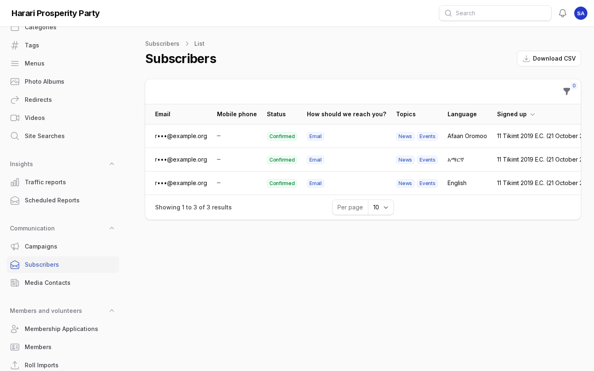
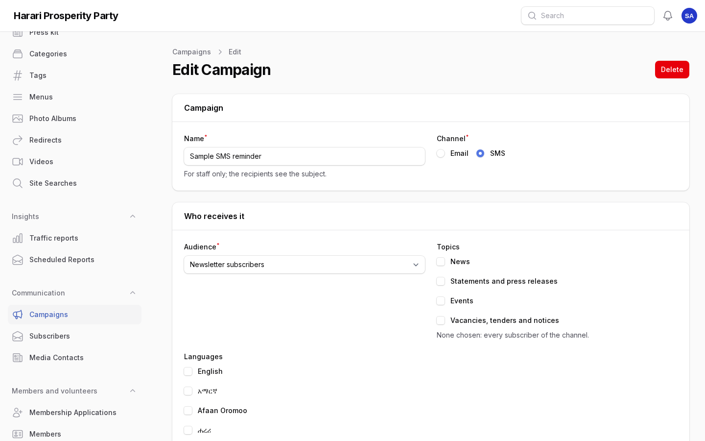
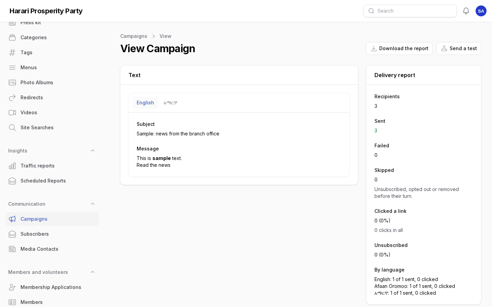
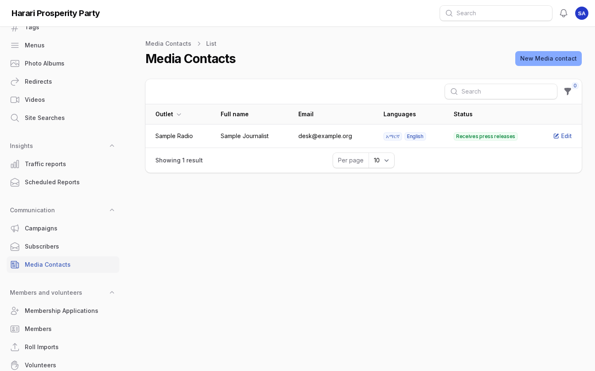
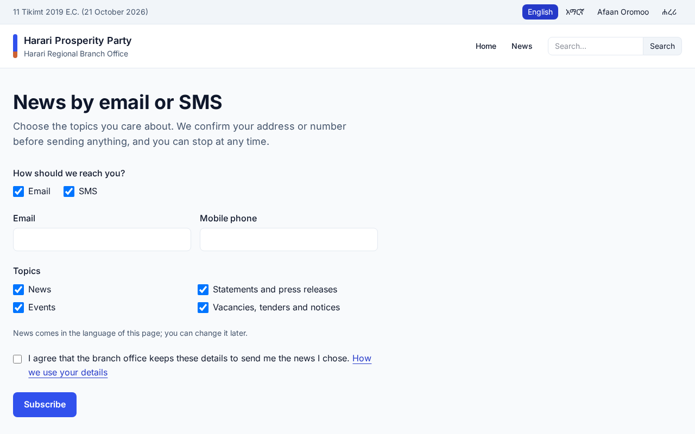

# Communication: newsletter, campaigns, media and Telegram

For staff of the Harari Regional Branch Office who send news by email and SMS, keep the media list and
receive notices on Telegram. Each section says who may do it. Amharic version:
[06-communication.am.md](06-communication.am.md).

Until the branch office's mail and SMS accounts are set up, emails go to the mail log and text messages to the
SMS log of the server, so nothing reaches real people from the test site.

## 1. Subscribers

Who: communications staff (**Communication → Subscribers**).

People subscribe themselves at `/{language}/newsletter` or with the email field in the footer of every page.
They choose email, SMS or both, and topics: news; statements and press releases; events; vacancies, tenders
and notices. An email address is confirmed by a link, a phone by a six-digit code; until then nothing is sent
to them. Each email they receive leads to their preferences, where they change topics, language and channels
or stop everything.

- The list shortens addresses and numbers. Filter by status (confirmed, waiting, unsubscribed), channel,
  topic or language.
- **Stop all news** on a subscriber's page is for someone who asked by phone or letter. Staff never add
  subscribers: people sign up themselves.
- **Download CSV** is for staff allowed to export subscribers; every download is in the audit log.
- Sign-ups never confirmed are deleted after a week.

## 2. Campaigns

Who: communications staff write campaigns; those allowed to send campaigns send them
(**Communication → Campaigns**).

1. **New campaign**: a name for staff, the channel (email or SMS) and who receives it:
   - **Newsletter subscribers**, optionally only some topics or languages;
   - **Members**, by woreda and status (only for staff who may see members, over their woredas);
   - **Active volunteers**, by woreda (only for staff who may see volunteers).
2. Write the text in each language you can. People get their own language, or the closest one you wrote
   (Harari readers get Amharic, then English). An email has a subject and a message (bold, links, lists);
   an SMS shows its length and number of parts, with the stop link counted, at most four parts.
3. Save. The page shows how many people the campaign would reach now.
4. **Send a test**: to your own email, or to a phone number you type, in the language you choose.
5. **Send now**, or **Send later** at a set date and time. A scheduled campaign can go **Back to draft**; one
   being sent can be stopped. Once sent, a campaign cannot be changed.

Messages go out a minute's worth at a time. Every email says why it was received and has a link to stop
these messages; every SMS ends with "Stop: <link>". A member or volunteer who stops them still receives
messages about their own membership.

### Delivery report

The campaign page shows how many were sent, are still to send, failed, were skipped (the person left before
their turn), clicked a link in the email and unsubscribed, with the figures per language. **Download the
report** gives one line per recipient without any address. The dashboard shows **Campaign results** and
**Subscribers**.

Opens are not counted unless the server setting `PORTAL_CAMPAIGN_OPEN_TRACKING` is switched on: many mail apps
block the invisible image used for it, and it counts people without asking them.

## 3. Media contacts and press releases

Who: communications staff (**Communication → Media contacts**).

1. **New media contact**: name, outlet, position, email, phone and the languages they take, in order of
   preference, with notes for staff.
2. Publish a press release, statement or speech as usual. On its edit page, choose **Send to the media**:
   to every contact or only those you pick. Each receives the title, the summary and a link to the full text,
   in the first of their languages the text is published in.
3. The **Sent to the media** tab of the post lists each contact, the language, whether it was sent, when and by
   whom.

Every press email has a link to stop receiving them; the contact then shows as "Opted out".

## 4. Notices on Telegram

Once the branch office has created the portal's Telegram bot and saved its token in **Settings →
Integrations** (and the webhook is registered, see the server runbook):

1. Open **Notifications** and choose **Connect Telegram**.
2. Open the link on the phone where you use Telegram and press **Start**. The bot confirms.
3. In **How I am notified**, tick **Telegram** for the kinds of notice you want there.

Send `/stop` to the bot, or choose **Disconnect Telegram**, to stop.

## 5. Privacy

**Administration → Privacy** also finds newsletter subscriptions and media contacts by email or phone, gives a
copy and deletes them on request.

## Screens

Screenshots of the admin with sample content (English admin language).

