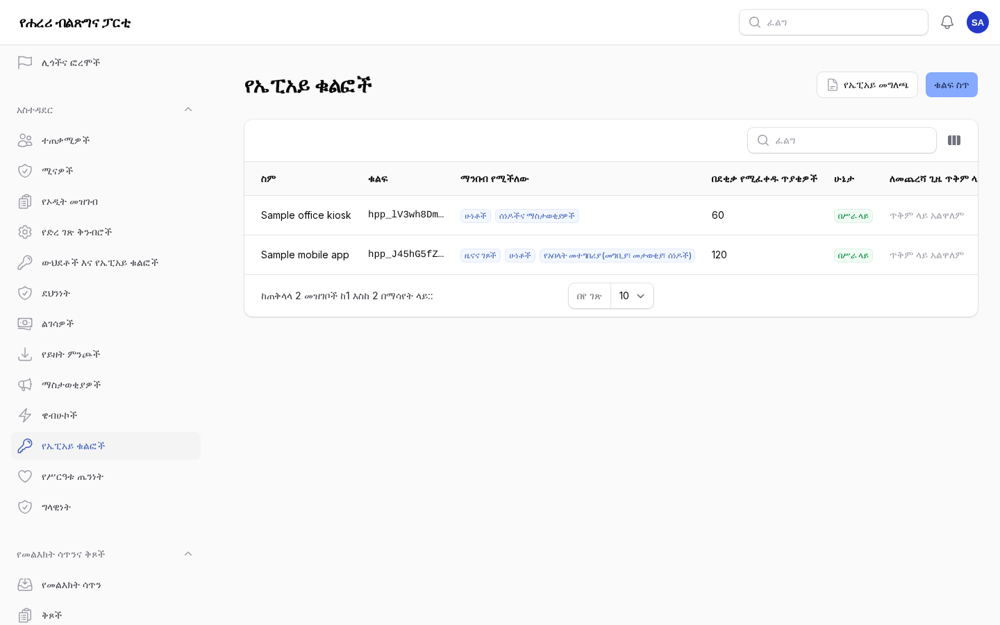
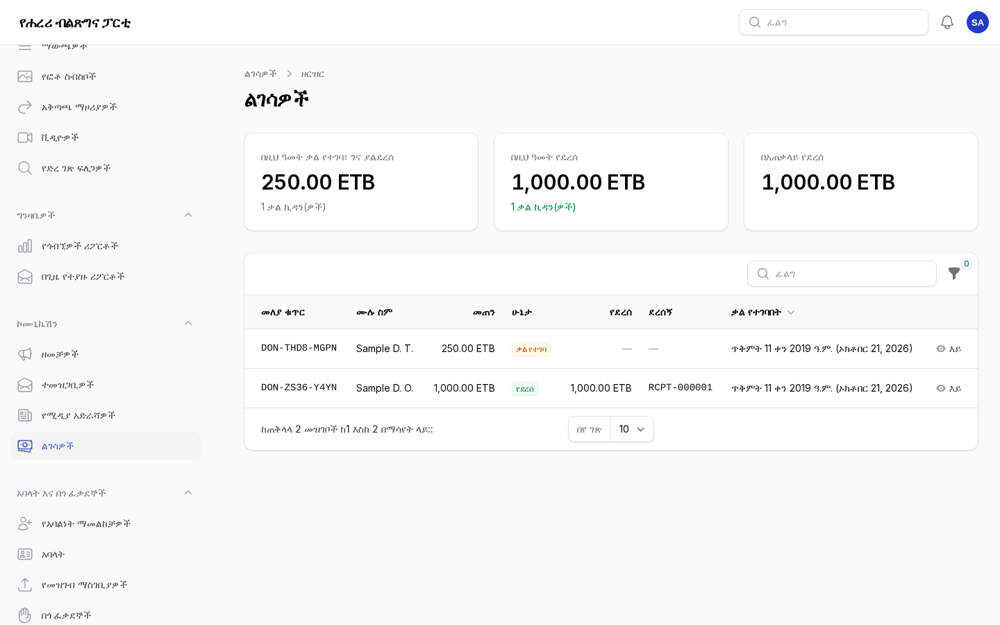
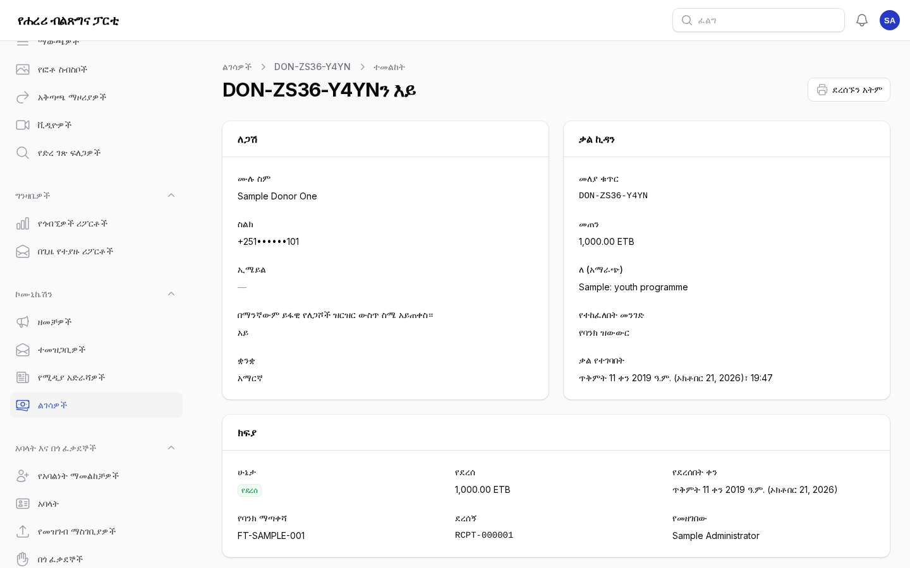
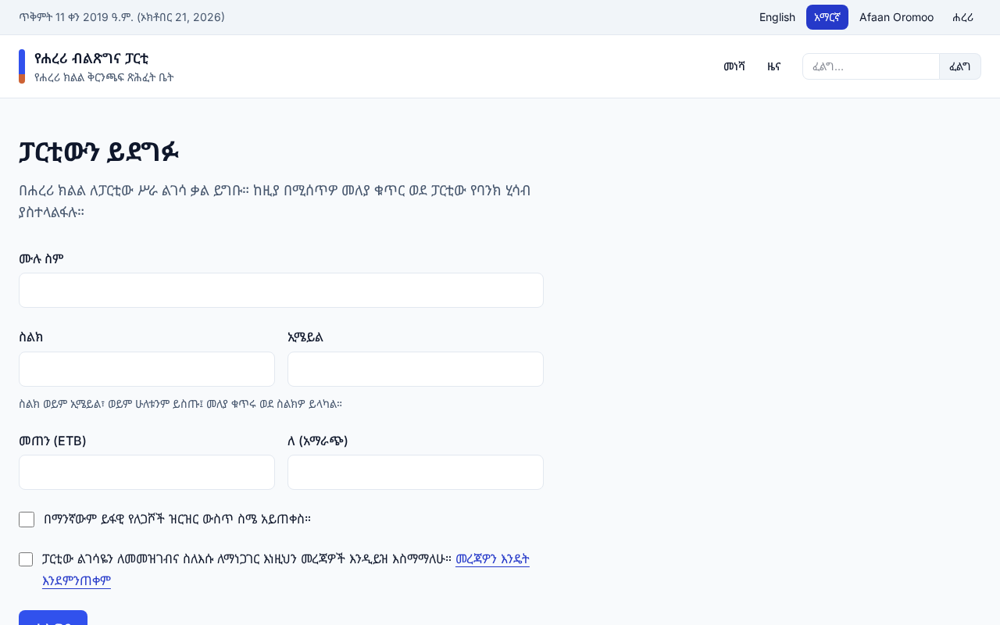

# ተጨማሪዎች፦ መተግበሪያዎች፣ ፋይዳ፣ ማጋራትና ልገሳዎች

ለዋና አስተዳዳሪዎችና ዜና ለሚያጋሩ፣ ልገሳዎችን ለሚመዘግቡ ሠራተኞች። እያንዳንዱ ክፍል ሥራውን ማን ሊያከናውን እንደሚችልና
ቅርንጫፍ ጽሕፈት ቤቱ አስቀድሞ ምን ማቅረብ እንዳለበት ይገልጻል። የእንግሊዝኛው ቅጂ፦ [07-extensions.md](07-extensions.md)።

## 1. ለመተግበሪያዎች የኤፒአይ ቁልፎች

ማን፦ ዋና አስተዳዳሪዎች (**አስተዳደር → የኤፒአይ ቁልፎች**)።

ፖርታሉ እንደ ቅርንጫፍ ጽሕፈት ቤቱ የሞባይል መተግበሪያ ወይም የጽሕፈት ቤት ኪዮስክ ላሉ መተግበሪያዎች በ`/api/v1` ይመልሳል፤
ይፋዊው ድረ ገጽ የሚያትመውን ያቀርባል፦ ዜናና ገጾች፣ ሁነቶች፣ ሰነዶች፣ ጽሕፈት ቤቶችና አመራሮች፣ ፕሮጀክቶችና ፍለጋ፣ በሁሉም
ቋንቋዎች። አዘጋጆች ሙሉውን መግለጫ በ`/api/v1/openapi.json` ያገኛሉ (በኤፒአይ ቁልፎች ገጽ ላይ ካለው **የኤፒአይ መግለጫ**
በስተጀርባም አለ)።

1. **ቁልፍ ስጥ**፦ ለመተግበሪያው ወይም ለመሣሪያው ስም፣ ማንበብ የሚችለውን፣ እና በደቂቃ ስንት ጥያቄዎች ማቅረብ እንደሚችል
   (ለአንድ መተግበሪያ 60 በቂ ነው)። የሚያበቃበት ቀን አማራጭ ነው።
2. ቁልፉ የሚታየው **አንድ ጊዜ ብቻ** ነው። ገልብጠው ደህንነቱ በተጠበቀ መንገድ ለመተግበሪያው አዘጋጅ ይስጡ፤ ፖርታሉ የሚይዘው
   የቁልፉን አሻራ ብቻ ነው።
3. ዝርዝሩ የእያንዳንዱን ቁልፍ የመጀመሪያ ፊደሎች፣ ሁኔታውንና ለመጨረሻ ጊዜ ጥቅም ላይ የዋለበትን ጊዜ ያሳያል።
4. የወጣ ወይም ከእንግዲህ የማይጠቅም ቁልፍ **ቁልፉን ሰርዝ**። የሚጠቀሙበት መተግበሪያዎች ወዲያውኑ ይቆማሉ፤ በምትኩ አዲስ ቁልፍ
   ይስጡ።

የአባላት መተግበሪያም አባላትን ያስገባል (**የአባላት መተግበሪያ** ፈቃድ)፦ እንደ አባላት ፖርታሉ በአጭር የጽሑፍ መልእክት ኮድ፤
ከዚያ መታወቂያውን፣ የአባሉን የሁነት ምዝገባዎችና ለአባላት ብቻ የሆኑ ሰነዶችን ያሳያል። አንድ አባል ቢበዛ በአምስት መሣሪያዎች
ላይ ሊገባ ይችላል። አንድ አባል ስልኩ ከጠፋበት የአባሉን ገጽ ከፍተው **ከአባላት መተግበሪያ አስወጣ** ይምረጡ።

## 2. በፋይዳ መግባት

ማን፦ ዋና አስተዳዳሪዎች ያዘጋጁታል (**መቼቶች → ውህደቶች → በፋይዳ መግቢያ**)። ቅርንጫፍ ጽሕፈት ቤቱ በብሔራዊ መታወቂያ
ፕሮግራም ዘንድ እስኪመዘገብ ድረስ ጠፍቶ ይቆያል።

1. በገጹ አናት ላይ **የፋይዳ መፈረሚያ ቁልፍ ፍጠር** ይምረጡ። ክፍሉ ከዚያ የፖርታሉን ይፋዊ ቁልፍና የመመለሻ አድራሻውን ያሳያል።
2. ቅርንጫፍ ጽሕፈት ቤቱ ያንን ይፋዊ ቁልፍና የመመለሻ አድራሻ ሰጥቶ ፖርታሉን በብሔራዊ መታወቂያ ፕሮግራም ዘንድ እንደ ተጠቃሚ ወገን
   ያስመዘግባል።
3. የተቀበሉትን የeSignet አድራሻና የደንበኛ መለያ ያስገቡ፤ **በፋይዳ መግባትን አቅርብ** አብርተው ያስቀምጡ።

ከዚያ አባላት በአባላት መግቢያ ገጹ ላይ **በፋይዳ ይግቡ** ያያሉ። ለመጀመሪያ ጊዜ አንድ አባል የሚታወቀው ፋይዳ የያዘው ስልክ
የአንድ የአባል መዝገብ ብቻ ስልክ ሲሆን ነው፤ ያለበለዚያ በአጭር የጽሑፍ መልእክት ኮድ ገብተው በገጻቸው ላይ **የፋይዳ
መታወቂያዬን አያይዝ** ይመርጣሉ። ማያያዝና መለያየት በአባሉ ታሪክ ውስጥ ይታያሉ።

## 3. ጽሑፍን ወደ ፌስቡክና ቴሌግራም ማጋራት

ማን፦ አሳታሚዎች፣ የኮሙኒኬሽን ኃላፊዎችና አስተዳዳሪዎች።

1. የታተመ ጽሑፍ ከፍተው **አጋራ** ይምረጡ።
2. የፌስቡክ ገጾችንና የቴሌግራም ቻናሎችን (በ**ማኅበራዊ ሚዲያ** ስር ያሉት ምንጮች) ይምረጡ፤ ቋንቋውን ይምረጡ፤ ከፈለጉ የራስዎን
   ቃላት ይጻፉ፤ ያለበለዚያ ርዕሱና ማጠቃለያው ይወጣሉ። የጽሑፉ ማገናኛ ሁልጊዜ ይጨመራል።
3. የጽሑፉ **የተጋራ** ትር እያንዳንዱን ገጽ ወይም ቻናል፣ መሳካቱን፣ ወደ ተጋራው ጽሑፍ የሚወስድ ማገናኛ፣ ማን መቼ እንዳጋራው
   ያሳያል።

ፌስቡክ ለማውጣት የተፈቀደ የገጽ ቶከን ያስፈልገዋል (ከማኅበራዊ ሚዲያ ምንጩ ጋር ወይም በውህደቶች ስር የሚቀመጥ)፤ ለቴሌግራም
የፖርታሉ ቦት የቻናሉ አስተዳዳሪ መሆን አለበት። እስከዚያ ድረስ ትሩ ማጋራቱ ያልተሳካበትን ምክንያት ያሳያል።

## 4. ልገሳዎች

ማን፦ ዋና አስተዳዳሪዎች ክፍሉን ያበሩታል (**መቼቶች → ልገሳዎች**)፤ አስተዳዳሪዎች ልገሳዎችን ይመዘግባሉ
(**ኮሙኒኬሽን → ልገሳዎች**)።

ክፍሉ ጠፍቷል፤ የልገሳ ገጹ የለም። የፓርቲው የሕግ አማካሪዎች የኢትዮጵያ የፖለቲካ ፋይናንስ ደንቦች እነዚህን ልገሳዎች እንደሚፈቅዱ
ካረጋገጡ በኋላ ብቻ ያብሩት።

1. በ**መቼቶች → ልገሳዎች** ውስጥ የፓርቲውን የባንክ ሂሳቦች፣ ገንዘቡን፣ ዝቅተኛውን ቃል ኪዳንና በእያንዳንዱ ቋንቋ ያሉትን ጽሑፎች
   ያስገቡ፤ ከዚያ ያብሩት። የልገሳ ገጹ በ`/{language}/donate` ይገኛል፤ ወደ አንድ ምናሌ ያክሉት።
2. ለጋሹ መጠን ቃል ይገባል፤ በባንክ ዝውውሩ ላይ የሚጽፈውን መለያ ቁጥር (`DON-…`) በገጹ ላይና በአጭር የጽሑፍ መልእክት
   ይቀበላል።
3. ባንኩ ክፍያውን ሲያሳይ ቃል ኪዳኑን ከፍተው **ክፍያውን መዝግብ** ይምረጡ፦ መጠኑን፣ ቀኑንና የባንኩን ማጣቀሻ። ደረሰኙ ቀጣዩን
   ቁጥር (`RCPT-…`) ያገኛል፤ ለጋሹም በአጭር የጽሑፍ መልእክት ምስጋና ይደርሰዋል።
4. **ደረሰኙን አትም** በለጋሹ ቋንቋ የሚታተም ደረሰኝ ይከፍታል። **ቃል ኪዳኑን ሰርዝ** ምክንያት ይፈልጋል። ቃል ኪዳኖች ፈጽሞ
   አይሰረዙም።
5. የዝርዝሩ አናት የዚህን ዓመት ክፍት ቃል ኪዳኖች፣ የዚህን ዓመት ክፍያዎችና አጠቃላዩን ያሳያል።

የግላዊነት ጥያቄዎች ልገሳዎችንም ያገኛሉ። የለጋሽን መረጃ ማጥፋት ስሙንና አድራሻዎቹን ያስወግዳል፤ ሂሳቡ የሚፈልጋቸውን መጠኖችና
የደረሰኝ ቁጥሮች ግን ያስቀራል።

## ገጾቹ ምን እንደሚመስሉ

የአስተዳደር ክፍሉ ምስሎች ከናሙና ይዘት ጋር (የአስተዳደር ቋንቋ፦ አማርኛ)።

