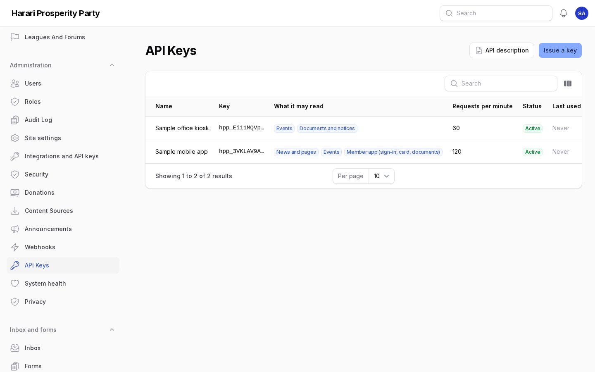
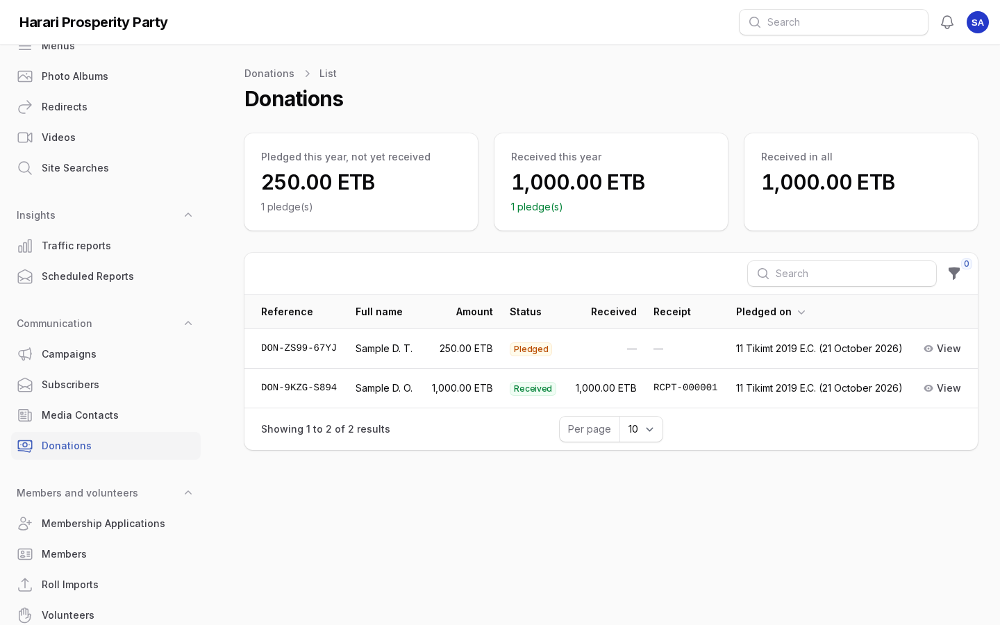
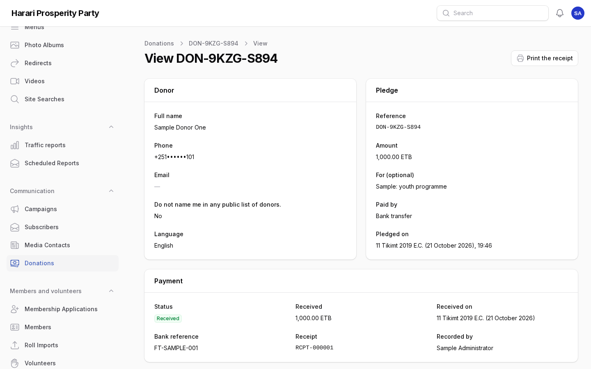
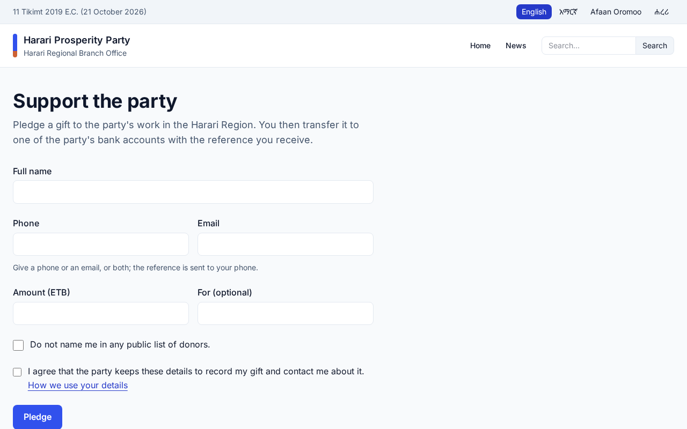

# Extensions: apps, Fayda, sharing, donations

For Super Admins and the staff who share news and record donations. Each section says who may do it and what
the branch office must provide first. Amharic version: [07-extensions.am.md](07-extensions.am.md).

## 1. API keys for apps

Who: Super Admins (**Administration → API keys**).

The portal answers apps such as the branch office's mobile app or an office kiosk at `/api/v1`, with what the
public site publishes: news and pages, events, documents, offices and leaders, projects and search, in every
language. Developers find the full description at `/api/v1/openapi.json` (also behind **API description** on
the API keys page).

1. **Issue a key**: a name for the app or device, what it may read, and how many requests a minute it may
   make (60 is plenty for an app). An expiry date is optional.
2. The key is shown **once**. Copy it and give it to the app's developer by a safe channel; the portal keeps
   only a fingerprint of it.
3. The list shows the first characters of each key, its status and when it was last used.
4. **Revoke** a key that leaked or is no longer used. Apps using it stop at once; issue a new key instead.

The member app also signs members in (scope **Member app**): with the same SMS code as the member portal, then
it shows the card, the member's event registrations and members-only documents. A member is signed in on at
most five devices. If a member loses their phone, open the member's page and choose **Sign out of the member
app**.

## 2. Sign-in with Fayda

Who: Super Admins set it up (**Settings → Integrations → Fayda sign-in**). It stays off until the branch office
is registered with the National ID Program.

1. Choose **Create the Fayda signing key** at the top of the page. The section then shows the portal's public
   key and the return address.
2. The branch office registers the portal with the National ID Program as a relying party, giving that public
   key and return address.
3. Enter the eSignet address and the client ID received, switch **Offer sign-in with Fayda** on and save.

Members then see **Sign in with Fayda** on the member sign-in page. The first time, a member is recognised by
the phone Fayda holds when it is the phone on exactly one member record; otherwise they sign in with an SMS code
and choose **Link my Fayda ID** on their page. Linking and unlinking appear in the member's history.

## 3. Sharing a post to Facebook and Telegram

Who: Publishers, Communications Officers and Admins.

1. Open a published post and choose **Share**.
2. Tick the Facebook pages and Telegram channels (the social sources under **Social media**), choose the
   language, and write your own words if you like; otherwise the title and summary are posted. The link to
   the post is always added.
3. The post's **Shared** tab shows each page or channel, whether it worked, a link to the shared post, who
   shared it and when.

Facebook needs a page token allowed to publish (kept with the social source or under Integrations); for
Telegram, the portal's bot must be an administrator of the channel. Until then the tab shows the reason a
share failed.

## 4. Donations

Who: Super Admins switch the module on (**Settings → Donations**); Admins record donations
(**Communication → Donations**).

The module is off: the donate page does not exist. Switch it on only after the party's legal advisers confirm
that Ethiopian political-finance rules allow these gifts.

1. In **Settings → Donations**, enter the party's bank accounts, the currency, the smallest pledge and the
   texts in each language, then switch it on. The donate page is at `/{language}/donate`; add it to a menu.
2. A donor pledges an amount and receives a reference (`DON-…`) to write on the bank transfer, on the page and
   by SMS.
3. When the bank shows the payment, open the pledge and choose **Record the payment**: the amount, the day and
   the bank's reference. The receipt gets the next number (`RCPT-…`) and the donor is thanked by SMS.
4. **Print the receipt** opens a printable receipt in the donor's language. **Cancel the pledge** needs a
   reason. Pledges are never deleted.
5. The top of the list shows this year's open pledges, this year's payments and the total.

Privacy requests also find donations. Erasing a donor removes their name and contacts but keeps the amounts and
receipt numbers the accounts need.

## Screens

Screenshots of the admin with sample content (English admin language).

